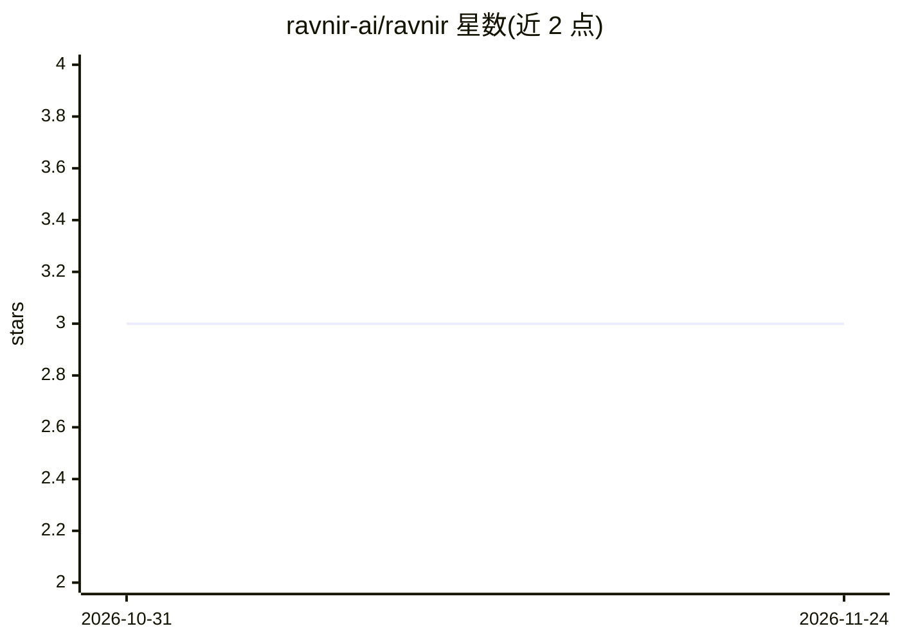

# ravnir-ai/ravnir

⭐ 3 · JavaScript · MIT · 推送 2026-10-30 · [GitHub](https://github.com/ravnir-ai/ravnir) · [官网](https://ravnir.dev) · 组织维护

**自托管持久化 AI agent 服务器，带可审查可回滚的共享记忆**

在自有服务器上运行持久化 agent：每个 agent 有持续线程、工作区、浏览器配置，关掉页面不中断任务，可定时执行例程。所有 agent 把学到的内容写入 git 管理的 Markdown 记忆库，支持查看 diff、提案审批和回滚。通过 OpenCode 或 OpenAI 兼容 API 接入模型，记录每次回复的 token 与费用并可设上限。提供 Linux 一键安装脚本（Podman/Docker 容器化）或 Node.js 22+ 源码运行；面向希望在自己服务器上运行个人 agent 的自托管用户。

## 筛选速览

| 维度 | 判定 | 备注 |
|---|---|---|
| AI 角色 | `ai-ecosystem` | LLM/agent 周边工具 |
| 许可风险 | `permissive` | MIT |
| 部署形态 | `library` | 以包/库形式分发 |
| 模型依赖 | — | README 未给出锁定关系 |
| 硬件要求 | — | 无带数字的原话,不猜 |
| 安装摩擦 | `low` | 无编译、无系统依赖或容器化 |
| 成熟度 | `idea` | |

## 能力要点

- git 管理的共享 Markdown 记忆库：commit/diff/提案/回滚
- 每次回复记录 token 与成本明细，支持日/月用量上限
- agent 间协作（ask_team 路由）、MCP 连接器与技能/插件商店
- 浏览器与 Linux 桌面 computer use、例程定时任务与通知

## 适用场景

- 在自己的服务器上部署可长期运行的持久化 agent
- 集中审查并回滚各 agent 对共享笔记的改动
- 给 agent 安排定时例程并追踪每个模型的实际花费

## 场景标签

`AI 助手` `GUI 自动化` `知识库管理` · 领域:效率与自动化

## 证据(README 行号)

> L5: Persistent agents on your own server, with one shared memory you can read, review and undo.
> L49: The installer uses rootless Podman or Docker, builds the server image, generates a sign-in password, and offers thr
> L65: Open localhost:3847. First run asks for your name and language, connects a model, offers starter agents, and can li

## 星数曲线

2026-10-31 3 → 2026-11-24 3（+0）

---
*卡片 v1 · prompt 1.4 · 生成 2026-11-21 · 置信度 high · 依据 README sha `9670f3e5a800` · [字段定义](../../DATASET.md)*
