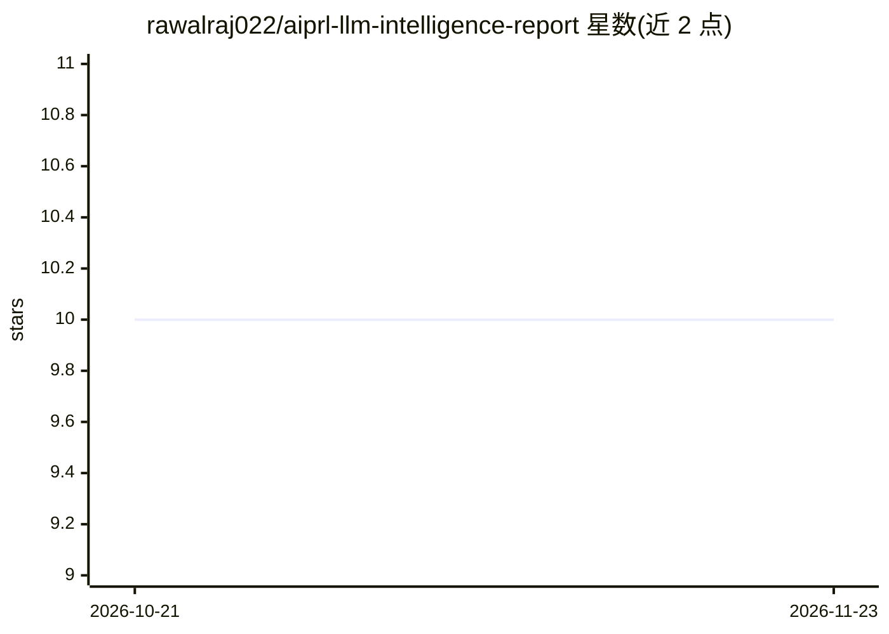

# rawalraj022/aiprl-llm-intelligence-report

⭐ 10 · Apache-2.0 · 推送 2025-12-07 · [GitHub](https://github.com/rawalraj022/aiprl-llm-intelligence-report) · [官网](https://github.com/AI-Parivartan-Research-Lab) · 个人维护

**面向 AI 决策者的月度 LLM 评估报告框架与清单**

该仓库建立 (AIPRL-LIR) 框架，以月度情报报告形式对大语言模型进行系统化评估与分析，覆盖 6 大类 23 项基准、Top 10 模型样例、全球托管服务商对比与研究要点。按开发者、企业、科研三类读者提供决策框架与阅读路径。README 明确声明内容仅用于教学与演示目的，数据与评估为示例性质，不代表真实模型性能。许可为 Apache 2.0，通过 git clone 获取报告。

## 筛选速览

| 维度 | 判定 | 备注 |
|---|---|---|
| AI 角色 | `ai-knowledge` | 知识聚合/清单类 |
| 许可风险 | `permissive` | Apache-2.0 |
| 部署形态 | `None` |  |
| 模型依赖 | — | README 未给出锁定关系 |
| 硬件要求 | — | 无带数字的原话,不猜 |
| 安装摩擦 | `low` | 无编译、无系统依赖或容器化 |
| 成熟度 | — | 结构信号不足 |

## 能力要点

- 6 大类别 23 项基准的标准化评估框架
- 面向开发者/企业/科研三类读者的决策框架表
- 月度报告结构：概览图、详细分析、分类深度报告
- 覆盖托管平台与基础设施服务商的分析维度

## 适用场景

- 为模型选型查找按用例组织的基准维度参考
- 了解 LLM 评估方法论的组织框架与流程步骤
- 企业做技术投资决策时参考报告阅读路径

## 场景标签

`精选清单` `模型评测` · 领域:评测与运维

## 证据(README 行号)

> L128: To provide the AI community with transparent, methodical frameworks for understanding LLM capabilities, performanc
> L138: > **⚠️ Important Notice**: This repository is created for educational and demonstration purposes. The data, evalua
> L132: - **📊 Comprehensive Benchmark Analysis**: Systematic evaluation across 23 benchmarks in 6 key categories

## 星数曲线

2026-10-21 10 → 2026-11-23 10（+0）

---
*卡片 v1 · prompt 1.4 · 生成 2026-11-19 · 置信度 high · 依据 README sha `5f30b9eff6f1` · [字段定义](../../DATASET.md)*
