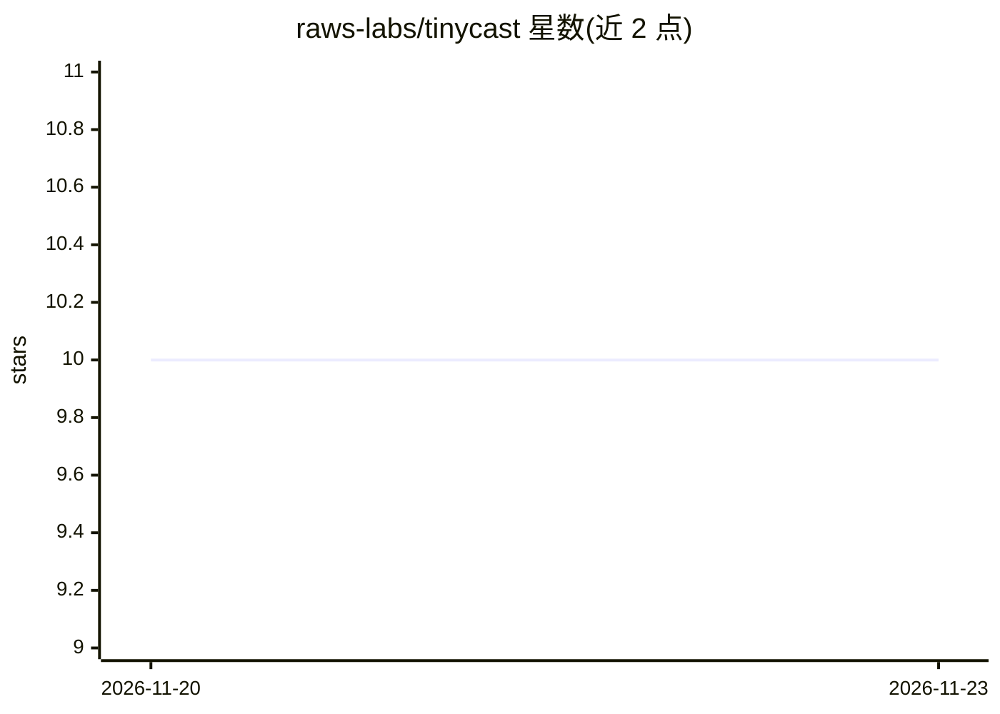

# raws-labs/tinycast

⭐ 10 · Python · Apache-2.0 · 推送 2026-09-12 · [GitHub](https://github.com/raws-labs/tinycast) · [官网](https://arxiv.org/abs/2608.15767) · 个人维护

**为嵌入式设备提供 146K 参数的零样本概率时序预测模型**

TinyCast 是一个 146,505 参数的注意力-free 时序基础模型，对未见过的序列做零样本预测并输出九个分位数而非点估计。结构上以膨胀因果卷积与零参数归一化周期图相位先验替代自注意力，全部学习算子为卷积/矩阵乘/归一化，可流式常量内存推理并量化到 INT8。提供 pip 安装、训练/导出/合成语料入口、复现 GIFT-Eval 评估的脚本与配套 Notebook；分布式训练编排不在包内，语料重建需 CUDA 设备。

## 筛选速览

| 维度 | 判定 | 备注 |
|---|---|---|
| AI 角色 | `ai-native` | 本体是模型或模型工具 |
| 许可风险 | `permissive` | Apache-2.0 |
| 部署形态 | `library` | 以包/库形式分发 |
| 模型依赖 | — | README 未给出锁定关系 |
| 硬件要求 | — | 无带数字的原话,不猜 |
| 安装摩擦 | `medium` | 含编译或系统依赖之一 |
| 成熟度 | — | 结构信号不足 |

## 能力要点

- 146,505 参数（fp32 权重 0.6 MB），支持 INT8 量化部署
- 零样本输出九分位数的概率预测
- 左填充卷积实现常量内存逐步流式推理
- 附 GIFT-Eval 评估复现脚本、训练/导出/语料生成入口

## 适用场景

- 在 Cortex-M 等嵌入式硬件上部署时序预测
- 对未见时间序列直接零样本生成概率预测
- 复现 GIFT-Eval 基准上的评估结果

## 场景标签

 · 领域:机器学习/时序预测

## 证据(README 行号)

> L3: **An attention-free, 146,505-parameter time-series foundation model.**
> L5: TinyCast forecasts unseen series zero-shot and returns nine quantiles rather than a point

## 星数曲线

2026-11-20 10 → 2026-11-23 10（+0）

---
*卡片 v1 · prompt 1.4 · 生成 2026-11-20 · 置信度 high · 依据 README sha `463ff2ee70f9` · [字段定义](../../DATASET.md)*
