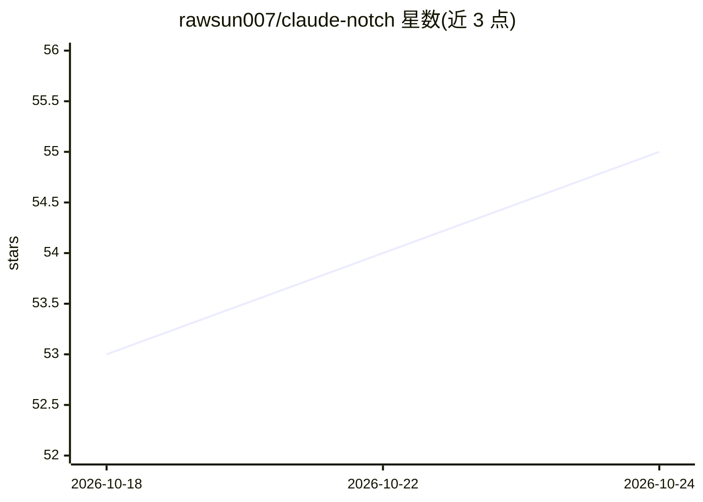

# rawsun007/claude-notch

⭐ 55 · Swift · NOASSERTION · 推送 2026-10-16 · [GitHub](https://github.com/rawsun007/claude-notch) · [官网](https://rawsun007.github.io/claude-notch/) · 个人维护

**在 Mac 刘海区审批 Claude Code 权限请求的菜单栏应用**

原生 SwiftUI 编写的 macOS 菜栏应用：通过 Claude Code 官方 hook 系统把权限请求、文件编辑 diff、AskUserQuestion 等提示以 Dynamic Island 风格浮层呈现在屏幕顶部，用户用键盘一键 Allow/Deny 且无需切回终端。本地运行，提供多会话追踪、上下文与费用估算、预算上限告警、危险命令 Touch ID 确认、会话内规则管理等。支持 10 种界面语言与 VoiceOver，提供 DMG、Homebrew 与源码构建三种安装方式。个人使用免费，许可证为 Noncommercial。

## 筛选速览

| 维度 | 判定 | 备注 |
|---|---|---|
| AI 角色 | `ai-ecosystem` | LLM/agent 周边工具 |
| 许可风险 | `none` | NOASSERTION |
| 部署形态 | `desktop` | 安装包/桌面程序 |
| 模型依赖 | locked-api |  |
| 硬件要求 | — | 无带数字的原话,不猜 |
| 安装摩擦 | `low` | 无编译、无系统依赖或容器化 |
| 成熟度 | — | 结构信号不足 |

## 能力要点

- 通过 Claude Code 官方 hook 系统在刘海区呈现权限请求与 diff，一键 Allow/Deny
- 上下文窗口占用与费用估算、按会话/按日的预算上限与 80%/100% 告警
- 危险命令（rm -rf/sudo/force-push）红色警告并要求 Touch ID 或长按确认
- 支持多会话并行追踪、⌥⌘N 全局快速发消息、claudenotch:// URL Scheme 外部驱动

## 适用场景

- 在编辑器中直接审批 Claude Code 的命令与文件编辑请求，不打断工作流
- 监控多个 Claude Code 会话的上下文占用与花费
- 为 Claude Code 设置每日/每会话预算上限防止超支

## 场景标签

 · 领域:开发者工具/AI 编码助手配套

## 证据(README 行号)

> L30: **ClaudeNotch is a tiny macOS menu-bar app that surfaces those prompts in a
> L36: It runs entirely on your machine, talks to Claude Code through its official hook

## 星数曲线

2026-10-18 53 → 2026-10-24 55（+2）

---
*卡片 v1 · prompt 1.4 · 生成 2026-10-24 · 置信度 high · 依据 README sha `766983a7d53c` · [字段定义](../../DATASET.md)*
