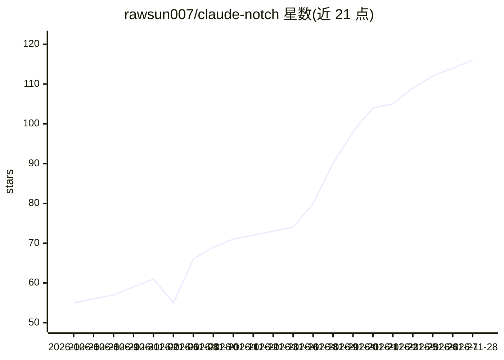

# rawsun007/claude-notch

⭐ 116 · Swift · NOASSERTION · 推送 2026-11-27 · [GitHub](https://github.com/rawsun007/claude-notch) · [官网](https://rawsun007.github.io/claude-notch/) · 组织维护

**让 macOS 用户在刘海屏批准 Claude Code 权限请求**

一款 SwiftUI 菜单栏应用，把 Claude Code 的权限请求、提问、通知显示在 Mac 刘海处的 Dynamic-Island 风格浮层里，用户可读取 diff 后按键 Allow/Deny，无需切回终端。通过 Claude Code 官方 hooks 系统通信，完全本地运行。支持最多 12 个会话并行、上下文与成本计量、按会话/按日预算上限、Touch ID 确认危险命令、VoiceOver 朗读与九种界面语言。需要 macOS 13+ 与 Apple Silicon 或 Intel 芯片。

## 筛选速览

| 维度 | 判定 | 备注 |
|---|---|---|
| AI 角色 | `ai-ecosystem` | LLM/agent 周边工具 |
| 许可风险 | `none` | NOASSERTION |
| 部署形态 | `desktop` | 安装包/桌面程序 |
| 模型依赖 | — | README 未给出锁定关系 |
| 硬件要求 | — | 无带数字的原话,不猜 |
| 安装摩擦 | `low` | 无编译、无系统依赖或容器化 |
| 成熟度 | — | 结构信号不足 |

## 能力要点

- 刘海浮层展示权限请求，diff 预览与一键 Allow/Deny
- 危险命令（rm -rf、sudo 等）红色警告并要求 Touch ID/长按确认
- 上下文窗口与成本计量、每日/每会话预算上限与告警
- 最多 12 个 Claude 会话并行管理，活动历史时间线

## 适用场景

- 写代码时不想反复切回终端批准 Claude Code 的命令
- 为 Claude Code 的 API 消耗设置预算上限和提醒
- 管理多个并行 Claude Code 会话并随时回复后台 agent

## 场景标签

 · 领域:开发者工具/AI 编程辅助

## 证据(README 行号)

> L30: **ClaudeNotch is a tiny macOS menu-bar app that surfaces those prompts in a
> L36: It runs entirely on your machine, talks to Claude Code through its official hook
> L74: |🪟 **Many sessions at once**|Up to twelve Claude sessions side by side, each with its own status, project, branch, 

## 星数曲线

2026-10-26 55 → 2026-11-28 116（+61）

---
*卡片 v1 · prompt 1.4 · 生成 2026-11-28 · 置信度 high · 依据 README sha `19dd9625c649` · [字段定义](../../DATASET.md)*
