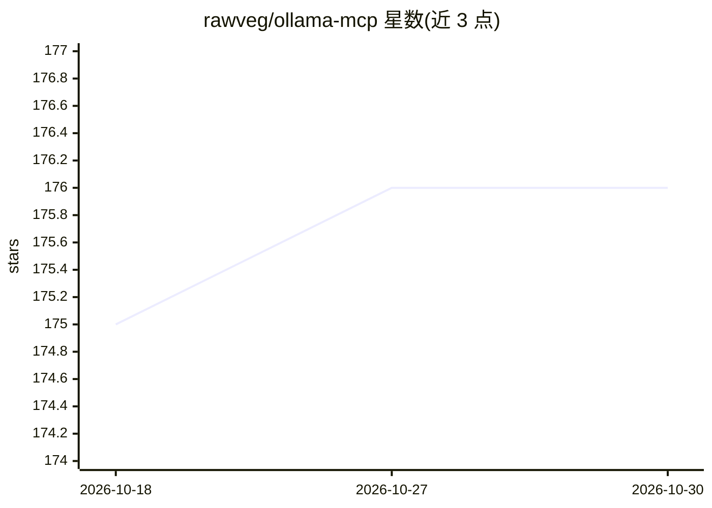

# rawveg/ollama-mcp

⭐ 176 · TypeScript · AGPL-3.0 · 推送 2026-08-13 · [GitHub](https://github.com/rawveg/ollama-mcp) · 个人维护

**把 Ollama SDK 全量封装为 MCP 工具的服务器**

用 TypeScript 编写的 MCP (Model Context Protocol) 服务器，将完整 Ollama SDK 暴露为 14 个 MCP 工具，覆盖模型管理（list/pull/push/copy/delete/create）、模型操作（generate/chat/embed）与基于 Ollama Cloud 的网页搜索/抓取，供 Claude Desktop、Cline 等 MCP 客户端调用本地及云端模型。采用热插拔自动加载架构，新增工具只需放入 src/tools/ 目录；Web 工具内置针对 429/5xx 的重试与指数退避逻辑，需 OLLAMA_API_KEY。通过 npm 全局安装或写入客户端 MCP 配置使用，开发需 Node.js v16+ 与本地运行的 Ollama。

## 筛选速览

| 维度 | 判定 | 备注 |
|---|---|---|
| AI 角色 | `ai-ecosystem` | LLM/agent 周边工具 |
| 许可风险 | `viral` | AGPL-3.0 |
| 部署形态 | `library` | 以包/库形式分发 |
| 模型依赖 | local-ok | 支持本地模型 |
| 硬件要求 | — | 无带数字的原话,不猜 |
| 安装摩擦 | `low` | 无编译、无系统依赖或容器化 |
| 成熟度 | — | 结构信号不足 |

## 能力要点

- 14 个 MCP 工具覆盖 Ollama SDK 的模型管理与生成/对话/嵌入功能
- 支持本地与 Ollama Cloud 混合模式（OLLAMA_HOST + API key）
- 热插拔自动加载架构，新增工具零服务器代码改动
- Web 工具内置重试策略（最多 3 次重试、30 秒超时、Retry-After 与指数退避）

## 适用场景

- 让 Claude Desktop 或 Cline 直接调用本地 Ollama 模型
- 在 MCP 客户端中执行模型下载、复制、删除等管理操作
- 通过 Ollama Cloud 在 MCP 客户端内使用网页搜索与抓取

## 场景标签

`模型网关` · 领域:Agent 开发

## 证据(README 行号)

> L10: An MCP (Model Context Protocol) server that exposes the complete Ollama SDK as MCP tools, enabling seamless integra
> L17: - 🔧 **14 Comprehensive Tools** - Full access to Ollama's SDK functionality

## 星数曲线

2026-10-18 175 → 2026-10-30 176（+1）

---
*卡片 v1 · prompt 1.4 · 生成 2026-10-22 · 置信度 high · 依据 README sha `baa455ec1d0a` · [字段定义](../../DATASET.md)*
