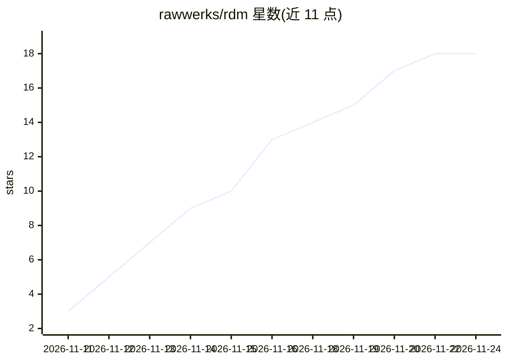

# rawwerks/rdm

⭐ 18 · Rust · MIT · 推送 2026-11-08 · [GitHub](https://github.com/rawwerks/rdm) · [官网](https://recursivedecisionmodels.com) · 组织维护

**Rust 框架：把决策模型放进递归循环驱动工具与语言模型**

递归决策模型（RDM）的 Rust 实现框架：决策模型读取状态与类型化问题，仅输出决策与概率（不写文本）；其答案选择下一步——运行工具、让语言模型写作、或对更小的状态子块再次提问（递归）。包含 systemone 协议 crate、多后端网关 one-system（hosted Jev/OpenRouter/llama.cpp）、WASM 构建及仲裁、地图维度、REPL 沙箱中的 RLM 等特性。18 个示例默认以无网络的 stand-in 规则运行，无需 API key，输出确定性；接真实模型需设 key 或本地 llama.cpp 服务。面向用 Rust 构建 Agent/决策循环的开发者。

## 筛选速览

| 维度 | 判定 | 备注 |
|---|---|---|
| AI 角色 | `ai-ecosystem` | LLM/agent 周边工具 |
| 许可风险 | `permissive` | MIT |
| 部署形态 | `library` | 以包/库形式分发 |
| 模型依赖 | local-ok | 支持本地模型 |
| 硬件要求 | — | 无带数字的原话,不猜 |
| 安装摩擦 | `medium` | 含编译或系统依赖之一 |
| 成熟度 | — | 结构信号不足 |

## 能力要点

- 决策模型只答类型化问题与概率，递归地选择工具、子问题与语言模型调用
- 多后端网关：hosted Jev、OpenRouter、llama.cpp 本地服务 Laya
- 无 key 时全部示例由 stand-in 固定规则回答，可离线确定性复现
- 仲裁机制：决策模型逐次裁决并发工具的取舍；Rlm 在 REPL 沙箱中带检查点地驱动语言模型写代码

## 适用场景

- 用 Rust 构建由决策模型驱动工具调用的 Agent 循环
- 在本地 llama.cpp 上运行开源决策模型 Laya 做分层检索/分类
- 把 RDM 搜索编译为 WebAssembly 在浏览器中运行

## 场景标签

`Agent 框架` · 领域:Agent 开发

## 证据(README 行号)

> L141: |`systemone`|The System One protocol: a request and a response as they are on the wire, the `DecisionModel` trait 
> L143: |`rdm`|The loop: `Signature` (the questions), `Tool` (what an answer can call), `Rdm` (the module), `Call` (a runn

## 星数曲线

2026-11-11 3 → 2026-11-24 18（+15）

---
*卡片 v1 · prompt 1.4 · 生成 2026-11-18 · 置信度 high · 依据 README sha `060beebaa9a1` · [字段定义](../../DATASET.md)*
