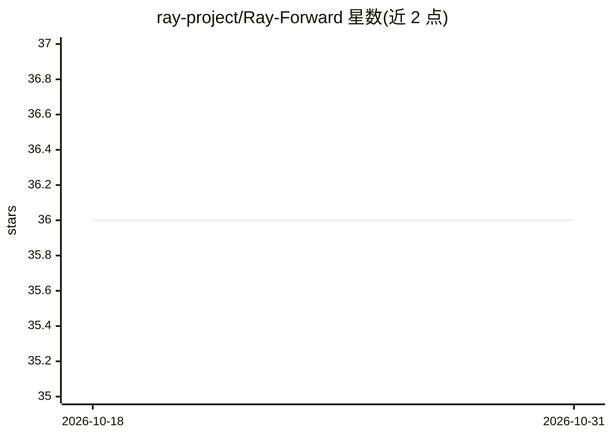

# ray-project/Ray-Forward

⭐ 36 · Apache-2.0 · 推送 2025-12-25 · [GitHub](https://github.com/ray-project/Ray-Forward) · 组织维护 · 中文 README

**Ray Forward 年度社区活动资源汇总页**

收集 Ray 中文社区年度活动 Ray Forward 的历届资源，包括活动回顾、幻灯片与视频等。活动面向本地 Ray 从业者，讨论实践用例与技术挑战。页面为资源合集，不提供软件安装或运行内容，README 同时提供中文版链接。

## 筛选速览

| 维度 | 判定 | 备注 |
|---|---|---|
| AI 角色 | `ai-knowledge` | 知识聚合/清单类 |
| 许可风险 | `permissive` | Apache-2.0 |
| 部署形态 | `None` |  |
| 模型依赖 | — | README 未给出锁定关系 |
| 硬件要求 | — | 无带数字的原话,不猜 |
| 安装摩擦 | `low` | 无编译、无系统依赖或容器化 |
| 成熟度 | — | 结构信号不足 |

## 能力要点

- 汇集历届 Ray Forward 活动的回顾、幻灯片与视频
- Ray 中文社区的年度活动资源页

## 适用场景

- 查找 Ray Forward 历届活动的演讲材料与视频
- 了解 Ray 中文社区的实践用例

## 场景标签

`精选清单` · 领域:学习与行业

## 证据(README 行号)

> L5: Ray Forward is the annual community event of the Ray Chinese community. The event brings together local Ray practiti
> L7: This page collects resources from past Ray Forward community events, including event recaps, slides, videos, and mor

## 星数曲线

2026-10-18 36 → 2026-10-31 36（+0）

---
*卡片 v1 · prompt 1.4 · 生成 2026-10-25 · 置信度 high · 依据 README sha `c1e049c13e72` · [字段定义](../../DATASET.md)*
