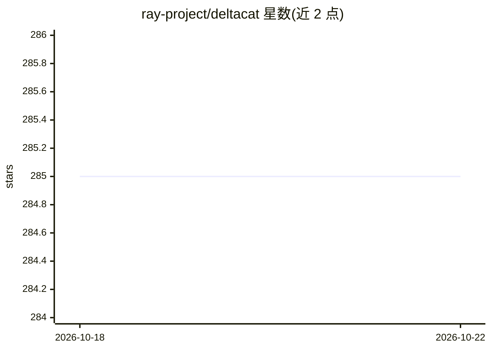

# ray-project/deltacat

⭐ 285 · Python · Apache-2.0 · 推送 2026-04-17 · [GitHub](https://github.com/ray-project/deltacat) · 组织维护

**基于 Ray 的多模态 Lakehouse，面向 ML/分析数据管理**

DeltaCAT 是一个可移植的多模态数据湖工具，基于 Ray、Apache Arrow 和 Daft 构建。提供 Catalog、Compute、Storage、Sync 四个组件：ACID 事务与时间旅行、零拷贝模式演化、多模态文件（图像/音频/视频/文本）零拷贝处理、跨表事务、目录级共享与复制。可在任意 PyArrow 兼容文件系统上运行，无需外部目录服务、锁管理器或键值存储。通过 pip 安装，面向构建 ML 与分析数据管道的开发者。限制：事务系统要求宿主机系统时钟准确且文件系统具备强读写一致性，本地笔记本建议仅用于测试。Sync 组件仍在开发中。

## 筛选速览

| 维度 | 判定 | 备注 |
|---|---|---|
| AI 角色 | `ai-ecosystem` | LLM/agent 周边工具 |
| 许可风险 | `permissive` | Apache-2.0 |
| 部署形态 | `library` | 以包/库形式分发 |
| 模型依赖 | — | README 未给出锁定关系 |
| 硬件要求 | — | 无带数字的原话,不猜 |
| 安装摩擦 | `low` | 无编译、无系统依赖或容器化 |
| 成熟度 | `idea` | |

## 能力要点

- ACID 合规的数据湖级事务与时间旅行查询
- 零拷贝多模态文件处理（图像/音频/视频/文本）
- 支持 Pandas/NumPy/Polars/PyArrow/Ray Data/Daft 等多种数据集类型读写
- 零拷贝同步到 Apache Iceberg 等表格式（Sync 组件开发中）

## 适用场景

- 构建多模态批处理与 LLM 批量推理管道
- 在 S3/GCS/Azure Blob 上管理大规模 ML 训练数据
- 需要目录级时间旅行与多表事务的数据湖管理
- 在本地与云之间共享和迁移数据湖目录

## 场景标签

 · 领域:数据基础设施/ML 数据工程

## 证据(README 行号)

> L3: DeltaCAT is a portable Multimodal Lakehouse powered by Ray, Apache Arrow, and Daft. It lets you create ACID-complian
> L243:  LLM Batch Inference

## 星数曲线

2026-10-18 285 → 2026-10-22 285（+0）

---
*卡片 v1 · prompt 1.4 · 生成 2026-10-22 · 置信度 high · 依据 README sha `f70290a63dbf` · [字段定义](../../DATASET.md)*
