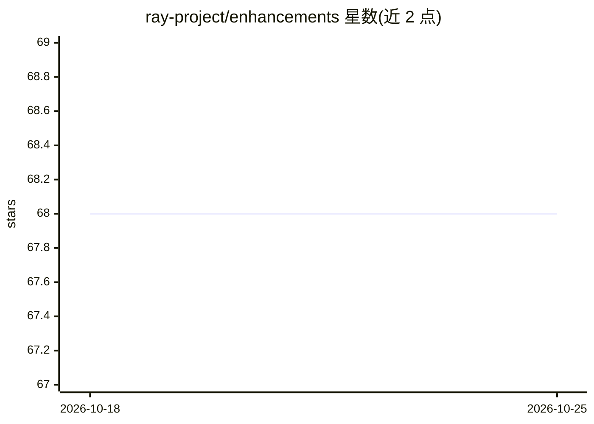

# ray-project/enhancements

⭐ 68 · Apache-2.0 · 推送 2026-10-01 · [GitHub](https://github.com/ray-project/enhancements) · 组织维护

**Ray 项目的功能提案（REP）流程与决策跟踪仓库**

Ray 项目的治理类仓库，跟踪 Ray Enhancement Proposals（REP）：提案以草稿 PR 形式提交，由资深 committer 担任 shepherd 打磨，经 ray-committers 邮件列表投票（非一致时由两位维护者终裁）决定接受或拒绝。仓库规定 REP 应包含动机、是否纳入 ray 主仓库的分层判断、监管人、设计架构、兼容与迁移计划、测试与验收标准等章节。面向 Ray 贡献者与 committer，不含可安装运行的软件。

## 筛选速览

| 维度 | 判定 | 备注 |
|---|---|---|
| AI 角色 | `ai-knowledge` | 知识聚合/清单类 |
| 许可风险 | `permissive` | Apache-2.0 |
| 部署形态 | `None` |  |
| 模型依赖 | — | README 未给出锁定关系 |
| 硬件要求 | — | 无带数字的原话,不猜 |
| 安装摩擦 | `low` | 无编译、无系统依赖或容器化 |
| 成熟度 | — | 结构信号不足 |

## 能力要点

- 定义 REP 从草稿 PR、shepherd 打磨到邮件列表投票的完整流程
- 规定提案模板：动机/分层归属/设计/兼容迁移/测试验收等章节
- 提供分层判断规则：优先在 ray 之外的独立仓库实现变更
- 公开列出所有开放与已合并的 REP PR

## 适用场景

- 为 Ray 提交重大功能或架构变更提案
- 查阅历史 REP 了解 Ray 的设计决策过程
- 作为开源项目治理流程的参考样例

## 场景标签

 · 领域:开源治理/流程文档

## 证据(README 行号)

> L2: This repo tracks Ray Enhancement Proposals (REP). The REP process is the main way to propose, discuss, and decide on
> L14: ### Should this change be within `ray` or outside?

## 星数曲线

2026-10-18 68 → 2026-10-25 68（+0）

---
*卡片 v1 · prompt 1.4 · 生成 2026-10-24 · 置信度 mid · 依据 README sha `a431a640f481` · [字段定义](../../DATASET.md)*
