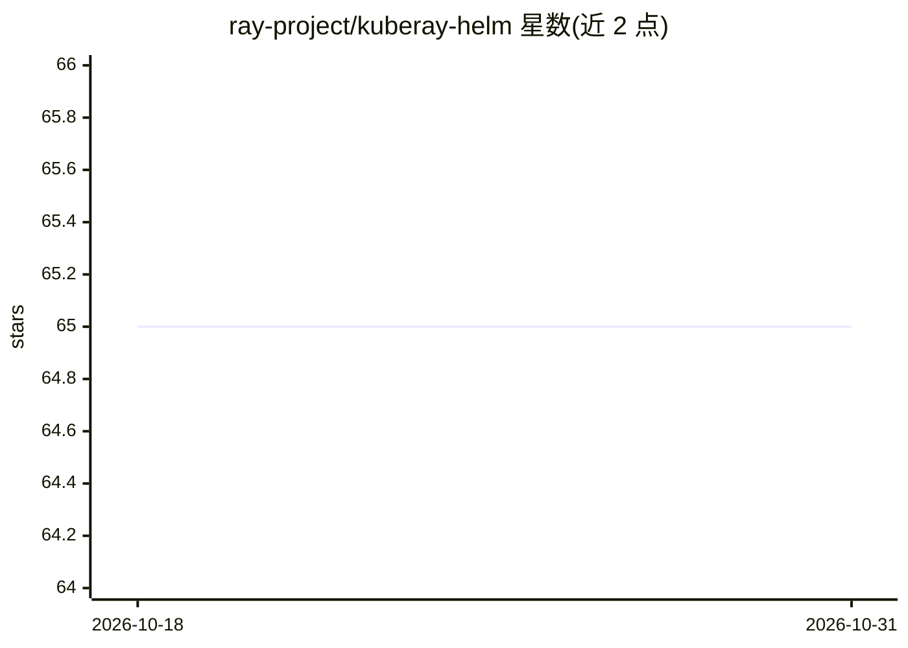

# ray-project/kuberay-helm

⭐ 65 · Mustache · 推送 2026-09-21 · [GitHub](https://github.com/ray-project/kuberay-helm) · 组织维护

**KubeRay 项目的 Helm charts 仓库，用于在 Kubernetes 部署 KubeRay**

托管 KubeRay 项目（v0.4.0 起）的 Helm charts，通过 helm repo add 与 helm install 命令在 Kubernetes 集群上安装 KubeRay operator，并可经 helm search repo 检索可用 charts。要求用户已安装 Helm。面向在 Kubernetes 上部署与管理 KubeRay（即 Ray 集群运维工具）的使用者。README 仅含安装用法说明，未涉及模型或算法细节。

## 筛选速览

| 维度 | 判定 | 备注 |
|---|---|---|
| AI 角色 | `ai-ecosystem` | LLM/agent 周边工具 |
| 许可风险 | `none` | — |
| 部署形态 | `library` | 以包/库形式分发 |
| 模型依赖 | — | README 未给出锁定关系 |
| 硬件要求 | — | 无带数字的原话,不猜 |
| 安装摩擦 | `low` | 无编译、无系统依赖或容器化 |
| 成熟度 | — | 结构信号不足 |

## 能力要点

- 托管 KubeRay 项目自 v0.4.0 起的 Helm charts
- 通过 helm repo add / helm install 安装 KubeRay operator
- 可用 helm search repo 检索 charts

## 适用场景

- 在 Kubernetes 集群上安装 KubeRay operator
- 以 Helm 方式部署和管理 KubeRay 相关组件

## 场景标签

`MLOps` · 领域:训练与推理

## 证据(README 行号)

> L3: This repository hosts Helm charts for the KubeRay project since KubeRay v0.4.0.
> L11: helm repo add kuberay https://ray-project.github.io/kuberay-helm/

## 星数曲线

2026-10-18 65 → 2026-10-31 65（+0）

---
*卡片 v1 · prompt 1.4 · 生成 2026-10-24 · 置信度 mid · 依据 README sha `0ff5f6b1c34e` · [字段定义](../../DATASET.md)*
