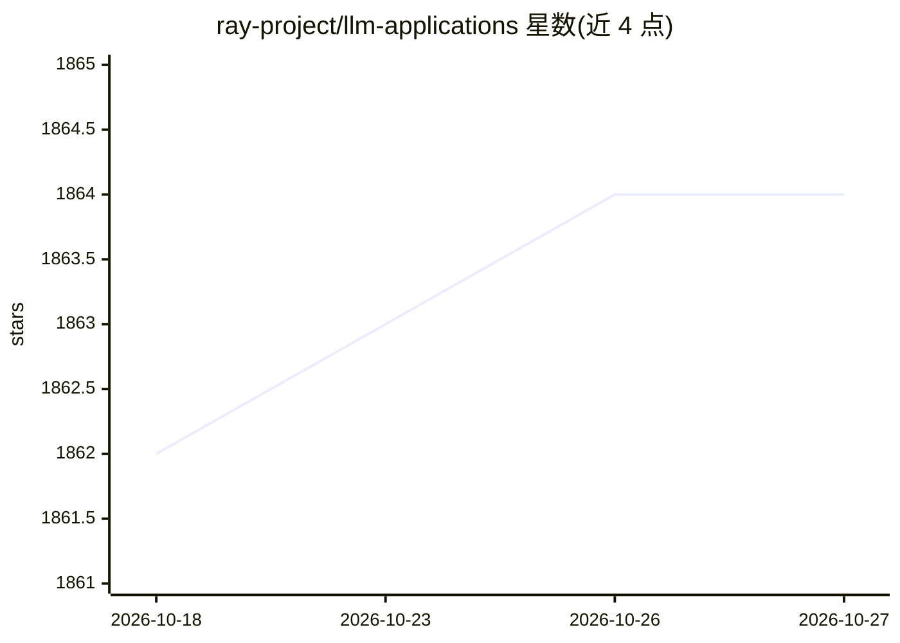

# ray-project/llm-applications

⭐ 1,864 · Jupyter Notebook · CC-BY-4.0 · 推送 2026-08-15 · [GitHub](https://github.com/ray-project/llm-applications) · 组织维护

**面向生产的 RAG LLM 应用开发指南（教程与笔记本）**

Ray 项目维护的教学仓库：通过交互式 notebook（rag.ipynb）从零开发基于 RAG 的 LLM 应用，内容覆盖数据加载、分块、嵌入、索引、服务与扩展，包含组件级与整体性能评估、OSS 与闭源模型的混合路由。使用 OpenAI API 访问 GPT 系列模型、Anyscale Endpoints 访问 Llama-2-70b 等 OSS 模型，建议使用 GPU 环境（Anyscale 工作区或自建云实例）。以 git clone 源码加 pip 安装依赖方式运行。

## 筛选速览

| 维度 | 判定 | 备注 |
|---|---|---|
| AI 角色 | `ai-knowledge` | 知识聚合/清单类 |
| 许可风险 | `viral` | CC-BY-4.0 |
| 部署形态 | `library` | 以包/库形式分发 |
| 模型依赖 | — | README 未给出锁定关系 |
| 硬件要求 | — | 无带数字的原话,不猜 |
| 安装摩擦 | `low` | 无编译、无系统依赖或容器化 |
| 成熟度 | — | 结构信号不足 |

## 能力要点

- 从零构建 RAG 应用的交互式 notebook 教程
- 覆盖 load/chunk/embed/index/serve 等组件的扩展方法
- 包含组件级与整体性能评估（retrieval_score/quality_score）
- OSS 与闭源 LLM 的混合路由方案

## 适用场景

- 学习如何构建生产级 RAG 应用
- 了解 LLM 应用的评估与混合路由方法
- 在 Ray/Anyscale 上实践可扩展的 LLM 服务

## 场景标签

`RAG` `教程课程` · 领域:知识与检索

## 证据(README 行号)

> L3: A comprehensive guide to building RAG-based LLM applications for production.
> L13: - 💻 Develop a retrieval augmented generation (RAG) based LLM application from scratch.

## 星数曲线

2026-10-18 1,862 → 2026-10-27 1,864（+2）

---
*卡片 v1 · prompt 1.4 · 生成 2026-10-21 · 置信度 mid · 依据 README sha `7ea10d2ebabb` · [字段定义](../../DATASET.md)*
