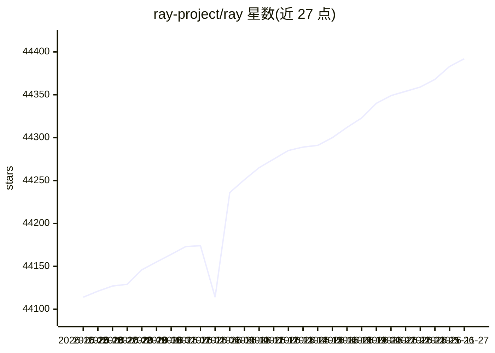

# ray-project/ray

⭐ 44,392 · Python · Apache-2.0 · 推送 2026-11-26 · [GitHub](https://github.com/ray-project/ray) · [官网](https://ray.io) · 组织维护

**ML 工作负载的分布式计算引擎与 AI 库集**

Ray 提供核心分布式运行时（Tasks/Actors/Objects 三类抽象）与一组 AI 库，覆盖数据集处理、分布式训练、超参数调优、强化学习和服务部署。同一份 Python 代码可从笔记本扩展到集群，支持任意云提供商与 Kubernetes 运行，并配套 Dashboard 监控与分布式调试器。以 pip 包安装，维护方为 Anyscale 支持的开源团队，附架构白皮书与多篇论文。

## 筛选速览

| 维度 | 判定 | 备注 |
|---|---|---|
| AI 角色 | `ai-ecosystem` | LLM/agent 周边工具 |
| 许可风险 | `permissive` | Apache-2.0 |
| 部署形态 | `library` | 以包/库形式分发 |
| 模型依赖 | — | README 未给出锁定关系 |
| 硬件要求 | — | 无带数字的原话,不猜 |
| 安装摩擦 | `low` | 无编译、无系统依赖或容器化 |
| 成熟度 | — | 结构信号不足 |

## 动量与使用信号

- 维护:`active` — 距上次 push 0.8 天,年发版 16,410 位贡献者
- 涨星:近 1 天 **+8**(自 20261016 起算)
- 安装:pypi 包 `ray` 月下载 13,701,060

## 能力要点

- 核心分布式运行时提供 Tasks/Actors/Objects 抽象
- AI 库覆盖 Data/Train/Tune/RLlib/Serve 五个方向
- 同一代码从笔记本无缝扩展到集群与 Kubernetes
- 提供 Ray Dashboard 监控与 Distributed Debugger 调试

## 适用场景

- 将单机训练/推理代码扩展到多机集群
- 做大规模超参数搜索与强化学习实验
- 部署可编程的模型服务
- 在 Kubernetes 或多家云上运行 ML 工作负载

## 场景标签

`强化学习` `模型训练` · 领域:训练与推理

## 证据(README 行号)

> L1: Ray is a unified framework for scaling AI and Python applications. Ray consists of a core distributed runtime and a 
> L34: With Ray, you can seamlessly scale the same code from a laptop to a cluster. Ray is designed to be general-purpose,

## 星数曲线

2026-10-25 44,114 → 2026-11-27 44,392（+278）

---
*卡片 v1 · prompt 1.4 · 生成 2026-11-22 · 置信度 high · 依据 README sha `8bb518915bbe` · [字段定义](../../DATASET.md)*
