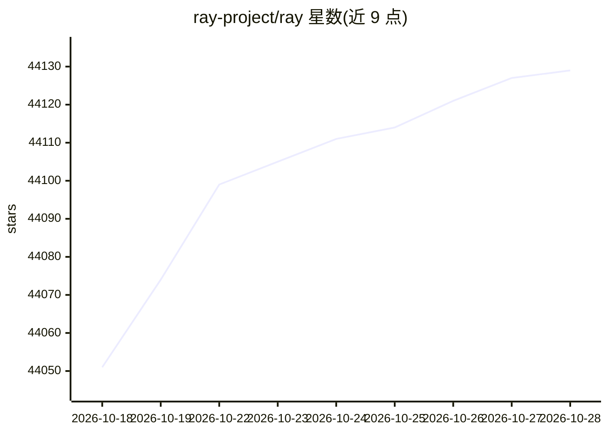

# ray-project/ray

⭐ 44,129 · Python · Apache-2.0 · 推送 2026-10-27 · [GitHub](https://github.com/ray-project/ray) · [官网](https://ray.io) · 组织维护

**分布式 AI 计算引擎：把 ML 工作负载从笔记本扩展到集群**

Ray 提供一个核心分布式运行时和一组 AI 库，用于扩展 AI 与 Python 应用。AI 库包括 Data（可扩展数据集）、Train（分布式训练）、Tune（超参数调优）、RLlib（强化学习）、Serve（服务化）；Ray Core 提供 Tasks、Actors、Objects 三种抽象。支持在任意机器、集群、云提供商与 Kubernetes 上运行，并有社区集成生态。通过 pip 安装，提供 Dashboard 监控与分布式调试器。

## 筛选速览

| 维度 | 判定 | 备注 |
|---|---|---|
| AI 角色 | `ai-native` | 本体是模型或模型工具 |
| 许可风险 | `permissive` | Apache-2.0 |
| 部署形态 | `library` | 以包/库形式分发 |
| 模型依赖 | — | README 未给出锁定关系 |
| 硬件要求 | — | 无带数字的原话,不猜 |
| 安装摩擦 | `low` | 无编译、无系统依赖或容器化 |
| 成熟度 | — | 结构信号不足 |

## 动量与使用信号

- 维护:`active` — 距上次 push 0.8 天,年发版 16,410 位贡献者
- 涨星:近 1 天 **+8**(自 20261016 起算)
- 安装:pypi 包 `ray` 月下载 13,701,060

## 能力要点

- 核心分布式运行时（Tasks/Actors/Objects）与 5 个 AI 库（Data/Train/Tune/RLlib/Serve）
- 同一代码可在笔记本与集群间扩展
- 运行于任意机器、集群、云提供商与 Kubernetes
- 提供 Ray Dashboard 监控与 Distributed Debugger 调试

## 适用场景

- 将单机 Python ML 代码扩展到多机集群运行
- 分布式训练与超参数调优
- 部署可扩展的模型推理服务
- 强化学习工作负载的规模化训练

## 场景标签

`强化学习` `推理引擎` `模型训练` · 领域:训练与推理

## 证据(README 行号)

> L18: Ray is a unified framework for scaling AI and Python applications. Ray consists of a core distributed runtime and a
> L47: Install Ray with: ``pip install ray``. For nightly wheels, see the
> L44: Ray runs on any machine, cluster, cloud provider, and Kubernetes, and features a growing

## 星数曲线

2026-10-18 44,051 → 2026-10-28 44,129（+78）

---
*卡片 v1 · prompt 1.4 · 生成 2026-10-18 · 置信度 high · 依据 README sha `61a2ca83f9c9` · [字段定义](../../DATASET.md)*
