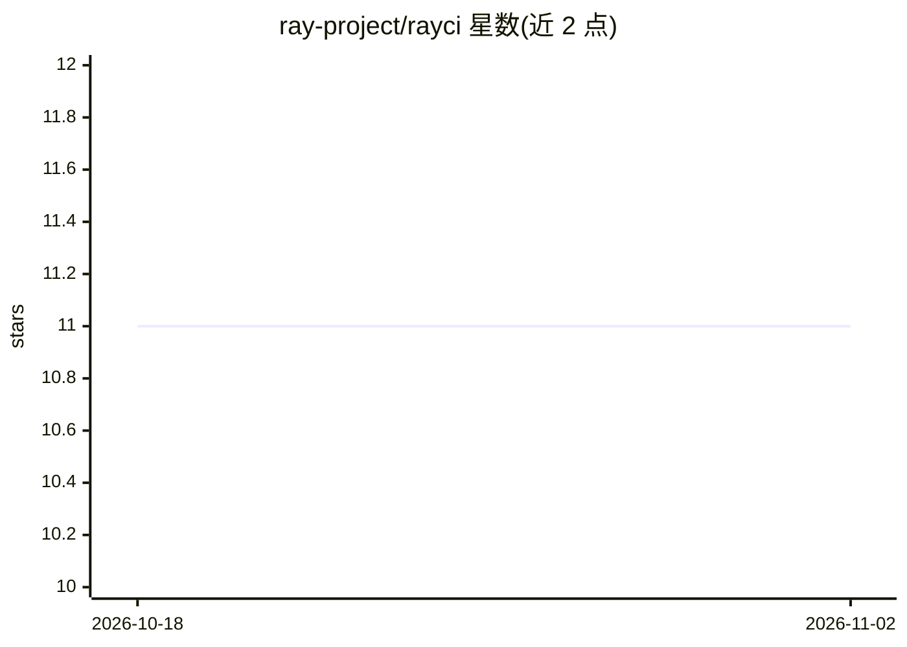

# ray-project/rayci

⭐ 11 · Go · Apache-2.0 · 推送 2026-10-27 · [GitHub](https://github.com/ray-project/rayci) · 组织维护

**Ray 项目在 Buildkite 上的 CI/CD 脚本与工具集**

包含 rayci 与 wanda 两个 Go 程序：rayci 读取测试定义文件并生成 Buildkite 流水线定义，wanda 以容器镜像仓库作为内容寻址构建缓存来构建容器镜像；另含 legacy CI/CD 与 KubeRay 流水线使用的脚本（ray_ci 与 ecosystem_ci 目录）。开发侧使用 pre-commit 钩子执行 go fmt、golines、go vet 等质量检查。面向 Ray 生态的维护者与贡献者，非终端用户产品。

## 筛选速览

| 维度 | 判定 | 备注 |
|---|---|---|
| AI 角色 | `ai-ecosystem` | LLM/agent 周边工具 |
| 许可风险 | `permissive` | Apache-2.0 |
| 部署形态 | `library` | 以包/库形式分发 |
| 模型依赖 | — | README 未给出锁定关系 |
| 硬件要求 | — | 无带数字的原话,不猜 |
| 安装摩擦 | `low` | 无编译、无系统依赖或容器化 |
| 成熟度 | — | 结构信号不足 |

## 能力要点

- rayci 读取测试定义并生成 Buildkite 流水线定义
- wanda 用容器镜像仓库做内容寻址的镜像构建缓存
- 含 legacy 与 KubeRay 流水线脚本
- pre-commit 钩子执行 go fmt/golines/go vet 等检查

## 适用场景

- 维护 Ray 在 Buildkite 上的 CI/CD 流水线
- 以内容寻址缓存加速容器镜像构建
- 为 KubeRay 等 Ray 生态项目复用 CI 脚本

## 场景标签

 · 领域:开发工具/CI-CD

## 证据(README 行号)

> L1: This repository contains scripts and progresm for Ray CI/CD on buildkite.
> L3: - `rayci`: program that reads test definition files and generates buildkite
> L5: - `wanda`: program that builds container images using a container registry as

## 星数曲线

2026-10-18 11 → 2026-11-02 11（+0）

---
*卡片 v1 · prompt 1.4 · 生成 2026-11-01 · 置信度 low · 依据 README sha `501055f57429` · [字段定义](../../DATASET.md)*
