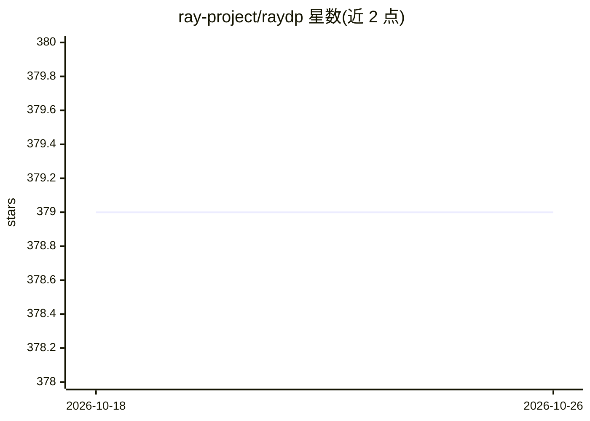

# ray-project/raydp

⭐ 379 · Scala · Apache-2.0 · 推送 2026-09-11 · [GitHub](https://github.com/ray-project/raydp) · 组织维护

**在 Ray 上运行 Spark 并衔接 AI 训练库的 Python API**

RayDP 提供 API 将 Spark 运行于 Ray 之上（Ray 作为 Spark 资源管理器，Spark executor 运行在 Ray actor 中），并支持 Spark DataFrame 与 Ray Dataset 互转，供 XGBoost、Ray Train、Horovod 等消费；另提供 scikit-learn 风格的 Estimator API（TorchEstimator/TFEstimator）直接在 Spark DataFrame 上做 PyTorch/TensorFlow 分布式训练。面向 ML 平台团队、数据科学家与数据工程师，用单个 Python 程序替代 Spark+训练双集群拼装。限制：恢复式转换不支持 Ray client 模式；依赖 Ray、PySpark 与 Java。

## 筛选速览

| 维度 | 判定 | 备注 |
|---|---|---|
| AI 角色 | `ai-ecosystem` | LLM/agent 周边工具 |
| 许可风险 | `permissive` | Apache-2.0 |
| 部署形态 | `library` | 以包/库形式分发 |
| 模型依赖 | — | README 未给出锁定关系 |
| 硬件要求 | — | 无带数字的原话,不猜 |
| 安装摩擦 | `low` | 无编译、无系统依赖或容器化 |
| 成熟度 | — | 结构信号不足 |

## 能力要点

- Ray 作为 Spark 资源管理器，Spark executor 运行于 Ray actor
- Spark DataFrame 与 Ray Dataset 双向转换，基于 Ray 内存对象交换
- TorchEstimator/TFEstimator 包装 Ray Train，直接在 Spark DataFrame 上训练
- 默认可恢复式转换：缓存 Arrow IPC 字节，容忍 Spark executor 失效

## 适用场景

- 在单个 Python 程序里组合 PySpark 与 Ray 生态库构建端到端数据+AI 流水线
- 云上按需运行 Spark 作业，免手工搭建 Spark 集群
- 把 Spark 数据处理结果直接喂给 XGBoost/PyTorch/TensorFlow 训练

## 场景标签

`MLOps` `模型训练` · 领域:训练与推理

## 证据(README 行号)

> L25: RayDP provides simple APIs for running Spark on Ray and APIs for converting a Spark DataFrame to a Ray Dataset whic
> L13: Spark as a popular big data framework plays an important role in data and AI pipelines. RayDP brings Spark to the R

## 星数曲线

2026-10-18 379 → 2026-10-26 379（+0）

---
*卡片 v1 · prompt 1.4 · 生成 2026-10-21 · 置信度 high · 依据 README sha `7468254d3941` · [字段定义](../../DATASET.md)*
