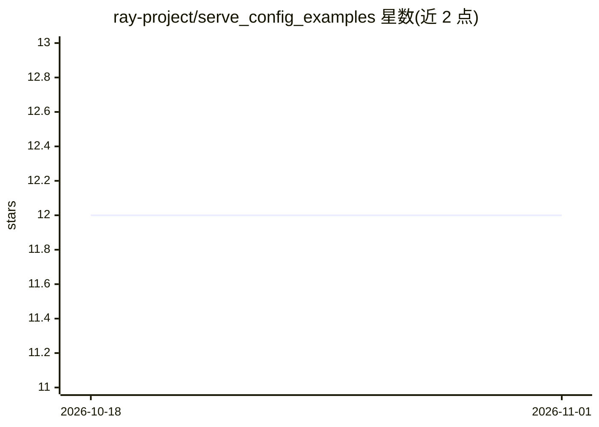

# ray-project/serve_config_examples

⭐ 12 · Python · 推送 2026-03-16 · [GitHub](https://github.com/ray-project/serve_config_examples) · 组织维护

**Ray Serve 官方示例集合：KubeRay RayService 的工作目录**

ray-project 维护的 Ray Serve 示例代码集合，涵盖 StableDiffusion 文生图模型等 Python 服务化脚本；其中 stable_diffusion/ 目录内容需与 Ray 官方文档中的 Stable Diffusion 章节保持同步。KubeRay RayService 示例将该仓库用作 runtime environment 的 working_dir，作为部署时的加载来源。面向使用 Ray Serve 或 KubeRay 部署模型的开发者。

## 筛选速览

| 维度 | 判定 | 备注 |
|---|---|---|
| AI 角色 | `ai-knowledge` | 知识聚合/清单类 |
| 许可风险 | `none` | — |
| 部署形态 | `None` |  |
| 模型依赖 | — | README 未给出锁定关系 |
| 硬件要求 | — | 无带数字的原话,不猜 |
| 安装摩擦 | `low` | 无编译、无系统依赖或容器化 |
| 成熟度 | — | 结构信号不足 |

## 能力要点

- Ray Serve 模型服务化示例脚本集合
- 含 StableDiffusion 文生图模型示例
- 被 KubeRay RayService 示例用作 working_dir

## 适用场景

- 学习 Ray Serve 部署模型的服务化写法
- 为 KubeRay RayService 部署提供 working_dir 代码源

## 场景标签

 · 领域:LLM/模型服务基础设施

## 证据(README 行号)

> L1: # Ray Serve examples
> L3: This repository is a collection of Ray Serve examples. KubeRay RayService examples
> L6: ## StableDiffusion: A text-to-image model

## 星数曲线

2026-10-18 12 → 2026-11-01 12（+0）

---
*卡片 v1 · prompt 1.4 · 生成 2026-11-01 · 置信度 mid · 依据 README sha `fec8c6631944` · [字段定义](../../DATASET.md)*
