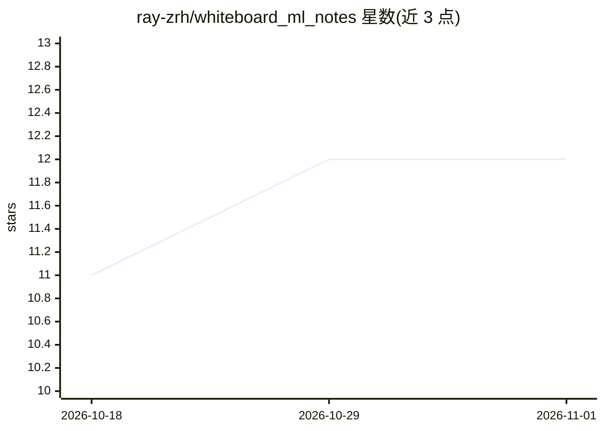

# ray-zrh/whiteboard_ml_notes

⭐ 12 · Python · 推送 2026-02-25 · [GitHub](https://github.com/ray-zrh/whiteboard_ml_notes) · 个人维护 · 中文 README

**机器学习数学推导的学习笔记仓库（33章）**

跟随 Bilibili 用户 shuhuai008 的【白板推导系列】视频整理的个人学习笔记仓库，覆盖绪论、数学基础、线性回归、SVM、EM、变分推断、高斯过程、生成模型、GAN、VAE 等 33 个章节（均已标为完成）。内容形式为逐步数学推导过程与 Python 脚本生成的可视化图表，按原视频章节组织，并以 Markdown 与 PDF（pdf/chapters 下按章下载）两种形式提供，推荐下载 PDF 以获得公式渲染效果。

## 筛选速览

| 维度 | 判定 | 备注 |
|---|---|---|
| AI 角色 | `ai-knowledge` | 知识聚合/清单类 |
| 许可风险 | `none` | — |
| 部署形态 | `None` |  |
| 模型依赖 | — | README 未给出锁定关系 |
| 硬件要求 | — | 无带数字的原话,不猜 |
| 安装摩擦 | `low` | 无编译、无系统依赖或容器化 |
| 成熟度 | — | 结构信号不足 |

## 能力要点

- 33 个章节的数学推导笔记，覆盖回归、SVM、概率图、贝叶斯方法、生成模型等主题
- Python 脚本生成可视化图表辅助理解几何意义
- 按原视频章节组织，提供 PDF 版本（pdf/chapters 目录按章下载）

## 适用场景

- 系统学习机器学习各主题的数学推导过程
- 通过可视化图表直观理解算法的几何意义
- 跟随白板推导系列视频配套阅读笔记

## 场景标签

`教程课程` · 领域:学习与行业

## 证据(README 行号)

> L5: 本仓库是【白板推导系列】的个人学习笔记。主要包含详细的数学推导过程和直观的可视化图表。
> L9: * **推导详尽**：包含一步步的数学证明 。

## 星数曲线

2026-10-18 11 → 2026-11-01 12（+1）

---
*卡片 v1 · prompt 1.4 · 生成 2026-11-01 · 置信度 high · 依据 README sha `5dbfe722eb2f` · [字段定义](../../DATASET.md)*
