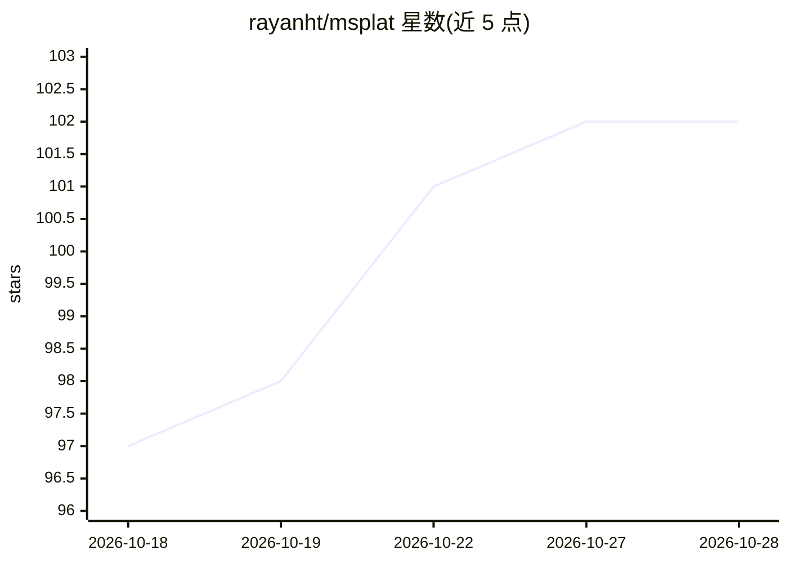

# rayanht/msplat

⭐ 102 · Metal · Apache-2.0 · 推送 2026-08-25 · [GitHub](https://github.com/rayanht/msplat) · 个人维护

**Apple Silicon 上的 3D 高斯泼溅训练引擎，全 Metal 实现**

面向 Apple Silicon（macOS 14+）的 3D Gaussian Splatting 训练引擎，整条流水线（投影、排序、光栅化、SSIM 损失、反向传播、Adam 优化器、致密化）以融合 Metal compute shader 运行，除系统框架外无外部依赖，不依赖 PyTorch。提供 Python（pip 安装）、Swift 包与独立 C++ CLI 三种使用方式，支持 COLMAP、Nerfstudio、Polycam 数据集格式。README 给出 M4 Max 上的训练时长与 PSNR/SSIM 基准数据（与 gsplat 的 CUDA 结果对比）。限制：仅限 Apple Silicon 的 macOS。

## 筛选速览

| 维度 | 判定 | 备注 |
|---|---|---|
| AI 角色 | `ai-native` | 本体是模型或模型工具 |
| 许可风险 | `permissive` | Apache-2.0 |
| 部署形态 | `library` | 以包/库形式分发 |
| 模型依赖 | — | README 未给出锁定关系 |
| 硬件要求 | — | 无带数字的原话,不猜 |
| 安装摩擦 | `high` | 编译与系统依赖俱全 |
| 成熟度 | — | 结构信号不足 |

## 能力要点

- 投影/排序/光栅化/SSIM/反向/Adam/致密化全部以融合 Metal shader 运行，无 PyTorch 依赖
- Python、Swift、C++ CLI 三种绑定与接口
- 支持 COLMAP、Nerfstudio、Polycam 数据集格式
- GPU 常驻致密化与 tile 内 bitonic 排序等设计决策

## 适用场景

- 在 Mac（Apple Silicon）上本地训练 3D 高斯泼溅场景
- 通过 Python/Swift 集成 3DGS 训练与渲染到 macOS/iOS 应用
- 用 C++ CLI 快速训练并评估 Mip-NeRF 360 等数据集

## 场景标签

 · 领域:3D 视觉/图形学

## 证据(README 行号)

> L3: A 3D Gaussian Splatting training engine for Apple Silicon, built entirely on Metal. No external dependencies beyond 
> L5: The entire training pipeline: projection, sorting, rasterization, SSIM loss, backward pass, Adam optimizer, and dens

## 星数曲线

2026-10-18 97 → 2026-10-28 102（+5）

---
*卡片 v1 · prompt 1.4 · 生成 2026-10-23 · 置信度 high · 依据 README sha `138f50d982ac` · [字段定义](../../DATASET.md)*
