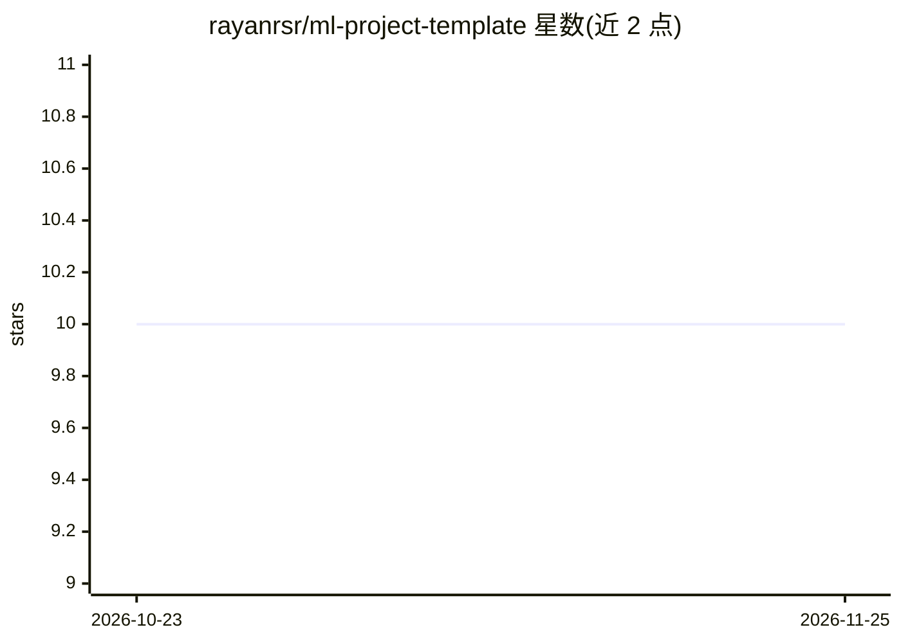

# rayanrsr/ml-project-template

⭐ 10 · Python · 推送 2026-09-23 · [GitHub](https://github.com/rayanrsr/ml-project-template) · [官网](https://rayanramoul.github.io/ml-project-template/) · 个人维护

**面向 ML/DL 开发者的 PyTorch Lightning+Hydra 项目脚手架模板**

一个机器学习/深度学习项目的仓库模板，通过 GitHub「Use this template」创建新项目。使用 Hydra 管理 yaml 配置并实例化 LightningModule 与 DataModule，用户只需实现 forward、training_step 等方法；内置 UV 包管理、pre-commit 钩子、Ruff、pytest 示例、Mkdocs 文档生成、GitHub issue/PR 模板与 justfile 命令集。支持 CPU/多 GPU/多 TPU，提供 Docker 化运行、LitServe 模型服务 API 示例、Kaggle 数据集下载脚本与 cloudpathlib 云端数据读取，README 另给出新人入职工业化练习流程。

## 筛选速览

| 维度 | 判定 | 备注 |
|---|---|---|
| AI 角色 | `ai-ecosystem` | LLM/agent 周边工具 |
| 许可风险 | `none` | — |
| 部署形态 | `self-host` | docker 或自建部署 |
| 模型依赖 | — | README 未给出锁定关系 |
| 硬件要求 | — | 无带数字的原话,不猜 |
| 安装摩擦 | `low` | 无编译、无系统依赖或容器化 |
| 成熟度 | — | 结构信号不足 |

## 能力要点

- Hydra yaml 配置实例化模型与 DataModule，支持命令行覆盖与 --multirun
- Docker 化项目（Dockerfile、可选 docker-compose）并通过 LitServe 提供 REST 服务示例
- UV 管理依赖，torch 以 cpu/gpu extra 可选安装
- Mkdocs 文档站、pre-commit 钩子与 GitHub 模板等工程化配套

## 适用场景

- 启动新的 PyTorch Lightning + Hydra 结构的 ML/DL 项目
- 把 Kaggle 训练 notebook 工业化为完整工程
- 统一团队的项目规范并用于新人入职

## 场景标签

 · 领域:机器学习工程化/开发模板

## 证据(README 行号)

> L12: A template for machine learning or deep learning projects.
> L56: The `train.py` or `eval.py` script is the entry point of the project. It uses Hydra to instantiate the model (Light

## 星数曲线

2026-10-23 10 → 2026-11-25 10（+0）

---
*卡片 v1 · prompt 1.4 · 生成 2026-11-19 · 置信度 mid · 依据 README sha `9424c1864f09` · [字段定义](../../DATASET.md)*
