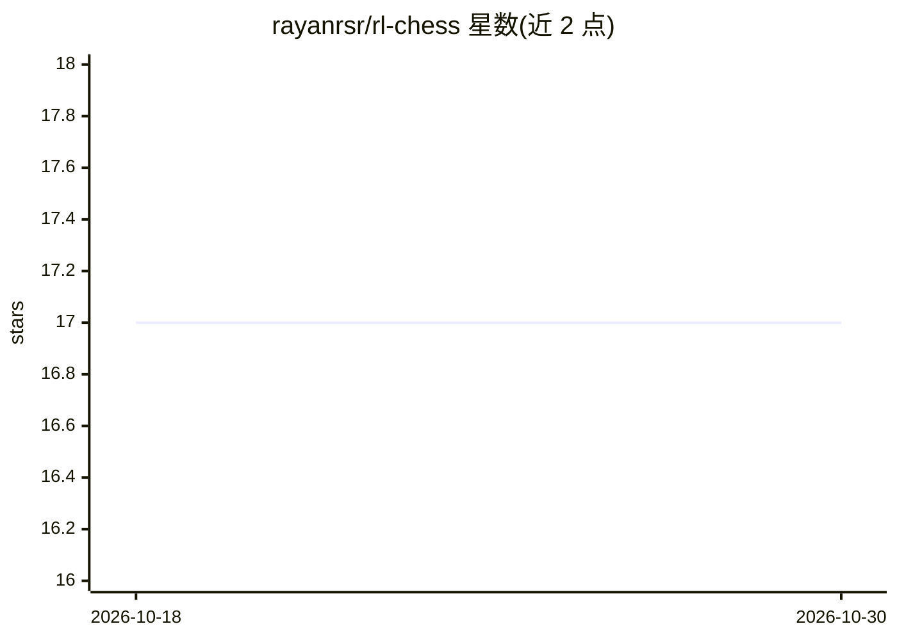

# rayanrsr/rl-chess

⭐ 17 · Python · 推送 2026-02-22 · [GitHub](https://github.com/rayanrsr/rl-chess) · 个人维护

**深度强化学习国际象棋 Web 游戏：训练 DQN 智能体并对弈**

基于 Flask 与 Deep-Q-Network 的开源国际象棋 Web 游戏：棋局以 64 维 numpy 数组表示状态，奖励采用 Monte-Carlo 方法按步长折算胜负回报，训练时用衰减的 Epsilon 控制随机探索；模型为 4 层 Dense 网络，输入 (65,) 维（64 状态 + 1 动作），输出 Q 值选步。前端用 chessboardjs/chessjs，AJAX 将状态发送至 Flask 后端，由 python-chess 复现棋局并调用模型预测。用户需 git clone 后自行运行训练脚本（建议 100 万+ 局）再启动本地服务器对弈；升变与王车易位的界面选择尚未实现。

## 筛选速览

| 维度 | 判定 | 备注 |
|---|---|---|
| AI 角色 | `ai-native` | 本体是模型或模型工具 |
| 许可风险 | `none` | — |
| 部署形态 | `library` | 以包/库形式分发 |
| 模型依赖 | — | README 未给出锁定关系 |
| 硬件要求 | — | 无带数字的原话,不猜 |
| 安装摩擦 | `low` | 无编译、无系统依赖或容器化 |
| 成熟度 | — | 结构信号不足 |

## 能力要点

- Deep-Q-Network（4 层 Dense）预测各着法 Q 值并择优
- Monte-Carlo 折算奖励 + 递减 Epsilon 控制探索
- Flask 后端 + chessboardjs/chessjs 前端的 Web 对弈架构
- 支持自定义超参数（局数、奖励、gamma、epsilon）训练

## 适用场景

- 我想训练一个自己的强化学习国际象棋 AI 并与它对弈
- 学习 Deep-Q-Larning 在棋类博弈中的实现方式
- 在本地部署一个可对弈的 Web 象棋页面

## 场景标签

 · 领域:游戏/强化学习

## 证据(README 行号)

> L2: > Web based and deep-q-learning powered chess game.
> L99: Chess is a complex game, and both the input and the target change constantly during the process and make training u

## 星数曲线

2026-10-18 17 → 2026-10-30 17（+0）

---
*卡片 v1 · prompt 1.4 · 生成 2026-10-29 · 置信度 mid · 依据 README sha `a025fa32300c` · [字段定义](../../DATASET.md)*
