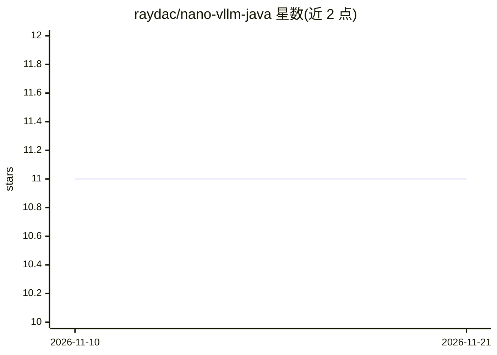

# raydac/nano-vllm-java

⭐ 11 · Java · Apache-2.0 · 推送 2026-11-20 · [GitHub](https://github.com/raydac/nano-vllm-java) · 个人维护

**供 Java 应用在 CPU 上本地运行预训练模型推理的库**

以 Maven/Gradle 依赖形式发布的纯 Java 21+ 推理库：加载用户已有的模型文件（Hugging Face 目录、.gguf、ONNX、fastText bin）并在 CPU 上运行推理，全程留在 JVM 内、无 Python 进程与 PyTorch。支持聊天、句向量、语音转写、语音合成、语言标注、图像检测/分割/姿态/深度等任务，内置 RAG 问答与 Java 函数工具调用机制，附带交互式示例工程与模型下载脚本。不训练模型，单引擎一次执行一个调用。

## 筛选速览

| 维度 | 判定 | 备注 |
|---|---|---|
| AI 角色 | `ai-ecosystem` | LLM/agent 周边工具 |
| 许可风险 | `permissive` | Apache-2.0 |
| 部署形态 | `None` |  |
| 模型依赖 | local-ok | 支持本地模型 |
| 硬件要求 | — | 无带数字的原话,不猜 |
| 安装摩擦 | `medium` | 含编译或系统依赖之一 |
| 成熟度 | — | 结构信号不足 |

## 能力要点

- 支持 Qwen3、Gemma 3、Llama、LFM2、BERT、Whisper、Piper、fastText、YOLO26 等模型家族
- Jev 机制：基于 next-token 概率读取选项/是/否/打分类决策，不解析生成文本
- 聊天轮次可调用注册的 Java 函数（工具调用，最多执行次数可配）
- 内置 RAG：可引用用户磁盘上的笔记作答

## 适用场景

- 在 Java 应用里加一个本地小模型的聊天回复或句向量检索
- 对 WAV 音频做本地语音转写或合成语音
- 用 YOLO26 ONNX 在 JVM 内做目标检测/分割/姿态估计
- 给固定选项列表的场景做带概率的决策输出

## 场景标签

`RAG` `语音识别` `语音合成` `目标检测` · 领域:内容生成

## 证据(README 行号)

> L11: A Java library that runs a pretrained model on the CPU and returns an answer. You add a Maven or Gradle dependency 
> L13: It does not train models. It loads files you already have and runs inference.
> L50: One `LLM` runs one call at a time. Share the loaded `LlmModel` across engines when calls should overlap. The rules 

## 星数曲线

2026-11-10 11 → 2026-11-21 11（+0）

---
*卡片 v1 · prompt 1.4 · 生成 2026-11-18 · 置信度 high · 依据 README sha `e908814501b8` · [字段定义](../../DATASET.md)*
