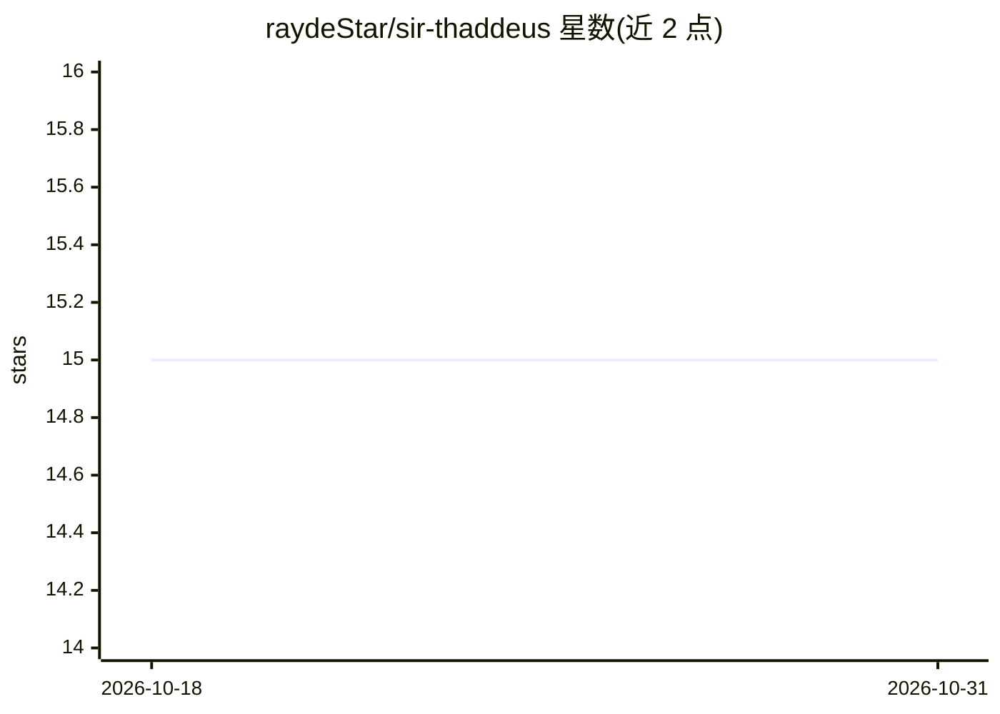

# raydeStar/sir-thaddeus

⭐ 15 · C# · Apache-2.0 · 推送 2026-10-26 · [GitHub](https://github.com/raydeStar/sir-thaddeus) · 个人维护

**Windows 本地优先 AI 助手工作区：自带模型、权限与记忆**

面向 Windows 个人用户的开源本地 AI 助手与 LLM agent 工作区，C#/.NET 运行时绑定 127.0.0.1，UI 与运行时间以轮换 bearer token 鉴权。接入 LM Studio、Ollama 或任意 OpenAI 兼容 /v1 端点；提供线程对话、带权限分组的 MCP 工具（Off/Ask/Always，Wiki 变更强制单次授权）、持久记忆、Markdown wiki、例程与逐轮 trace，支持急停。项目以可证伪实验方法度量 harness 对固定小模型的增益，发布含基准结果的研究报告。

## 筛选速览

| 维度 | 判定 | 备注 |
|---|---|---|
| AI 角色 | `ai-native` | 本体是模型或模型工具 |
| 许可风险 | `permissive` | Apache-2.0 |
| 部署形态 | `desktop` | 安装包/桌面程序 |
| 模型依赖 | local-ok | 支持本地模型 |
| 硬件要求 | — | 无带数字的原话,不猜 |
| 安装摩擦 | `medium` | 含编译或系统依赖之一 |
| 成熟度 | — | 结构信号不足 |

## 能力要点

- 权限分组 Off/Ask/Always，Wiki 状态变更每次需新授权
- 持久记忆 + Markdown wiki（版本历史、导入导出、AI 编辑）
- 接入 LM Studio / Ollama / OpenAI 兼容端点，可完全离线运行
- 注册式顺序实验协议与可复现的本地 agent harness 基准

## 适用场景

- 在 Windows 上运行本地模型并保留私有记忆与知识库
- 在敏感工具（文件/网络/屏幕）执行前逐项审批
- 复现小模型 + harness 的工程实验证据

## 场景标签

`AI 助手` `模型评测` `Agent 记忆` · 领域:Agent 开发

## 证据(README 行号)

> L31: **Sir Thaddeus is an open-source, local-first AI assistant and local LLM agent
> L34: give your model a private workspace: threaded chat, permissioned MCP tools,

## 星数曲线

2026-10-18 15 → 2026-10-31 15（+0）

---
*卡片 v1 · prompt 1.4 · 生成 2026-10-30 · 置信度 high · 依据 README sha `9683ea5680d9` · [字段定义](../../DATASET.md)*
