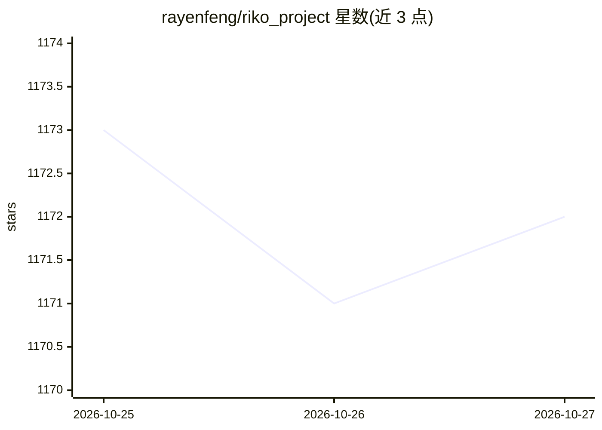

# rayenfeng/riko_project

⭐ 1,172 · Python · MIT · 推送 2026-10-23 · [GitHub](https://github.com/rayenfeng/riko_project) · 个人维护

**本地运行的开源动漫 AI 语音陪伴助手，含 3D 口型同步虚拟形象**

用户在自有 PC 上搭建的语音对话陪伴程序：按键说话后由 Faster-Whisper（本地）或 Groq Whisper 转文字，OpenAI GPT 按配置的个性生成回复，再经 GPT-SoVITS（本地克隆）或 Fish Audio 合成语音，浏览器中的 VRM 虚拟形象随语音做口型同步。人格、形象与声音集中在单一配置文件中。代码总量不足 500 行、每个环节独立成文件以便修改。需要 OpenAI API key，GitHub issues 不提供支持。

## 筛选速览

| 维度 | 判定 | 备注 |
|---|---|---|
| AI 角色 | `ai-native` | 本体是模型或模型工具 |
| 许可风险 | `permissive` | MIT |
| 部署形态 | `None` |  |
| 模型依赖 | locked-api |  |
| 硬件要求 | — | 无带数字的原话,不猜 |
| 安装摩擦 | `low` | 无编译、无系统依赖或容器化 |
| 成熟度 | — | 结构信号不足 |

## 能力要点

- 完整语音对话链路：ASR（Faster-Whisper/Groq）→ LLM（OpenAI GPT）→ TTS（GPT-SoVITS/Fish Audio）→ VRM 形象口型同步
- 人格、VRM 形象与声音均在 character_config.yaml 单文件配置
- 核心代码不足 500 行，各环节（asr/llm/tts/viewer）独立成文件可单独运行
- 启动前自检缺失的 key、服务或文件并提示修复方式

## 适用场景

- 在自己电脑上跑一个可自定义性格与声音的动漫语音陪伴角色
- 用自己的声音片段克隆专属语音
- 以此不到 500 行的代码库为基座改造成自己的对话角色

## 场景标签

`语音 Agent` · 领域:对话与助手

## 证据(README 行号)

> L6:  An anime AI companion that runs on your own PC, with her own voice and a 3D avatar that lip-syncs every word.
> L38: |👂 **Understands**|Speech to text with Faster-Whisper on your own PC, or Groq's fast online Whisper.|
> L39: |🧠 **Thinks**|Replies come from OpenAI GPT, in whatever personality you write for her.|

## 星数曲线

2026-10-25 1,173 → 2026-10-27 1,172（-1）

---
*卡片 v1 · prompt 1.4 · 生成 2026-10-24 · 置信度 high · 依据 README sha `a56624226e03` · [字段定义](../../DATASET.md)*
