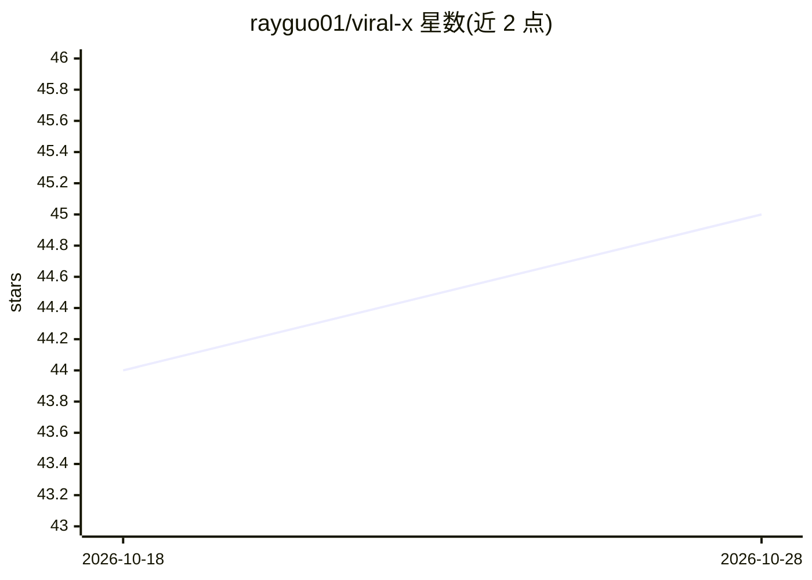

# rayguo01/viral-x

⭐ 46 · JavaScript · MIT · 推送 2026-01-24 · [GitHub](https://github.com/rayguo01/viral-x) · [官网](https://viral-x.app/) · 个人维护 · 中文 README

**AI 驱动的 X 平台爆款内容生成器，覆盖选题到发布**

面向 X（Twitter）内容创作者的 Web 应用：自动抓取 X 平台与国内热点（每小时更新），基于方法论生成帖子，提供 AI 评分与优化建议、大V写作风格模仿、Gemini 配图生成，并经 OAuth 授权后一键发布。技术栈为 Node.js + Express + PostgreSQL（推荐 Neon），AI 能力通过调用本机 Claude CLI 与 Gemini API 实现（未使用 Claude API），需预装 Claude CLI。支持 PM2 与 Docker 部署。

## 筛选速览

| 维度 | 判定 | 备注 |
|---|---|---|
| AI 角色 | `ai-native` | 本体是模型或模型工具 |
| 许可风险 | `permissive` | MIT |
| 部署形态 | `self-host` | docker 或自建部署 |
| 模型依赖 | locked-api |  |
| 硬件要求 | — | 无带数字的原话,不猜 |
| 安装摩擦 | `low` | 无编译、无系统依赖或容器化 |
| 成熟度 | — | 结构信号不足 |

## 能力要点

- 实时抓取 X 平台与国内热点，每小时更新
- AI 内容生成与爆款评分优化、大V风格模仿
- Gemini 生成与内容匹配的配图
- OAuth 授权后一键发布到 X 平台

## 适用场景

- 追踪热点并快速生成可发布的 X 帖子
- 模仿特定大V的写作风格产出内容
- 为帖子生成配图并直接发布

## 场景标签

`AI 写作` `图像生成` `网页抓取` · 领域:效率与自动化

## 证据(README 行号)

> L16: - **AI 内容生成** - 基于方法论，生成高质量帖子
> L23: - 调用claude cli进行通信，没有使用claude api
> L97: |AI 能力|Claude CLI + Gemini API|

## 星数曲线

2026-10-18 44 → 2026-10-28 45（+1）

---
*卡片 v1 · prompt 1.4 · 生成 2026-10-25 · 置信度 mid · 依据 README sha `48dcb44b18f2` · [字段定义](../../DATASET.md)*
