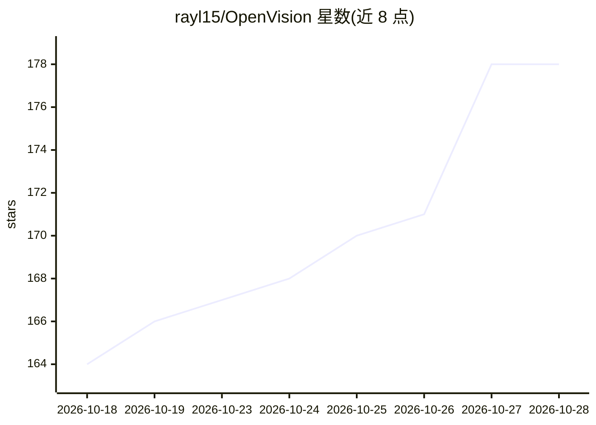

# rayl15/OpenVision

⭐ 178 · Swift · MIT · 推送 2026-10-04 · [GitHub](https://github.com/rayl15/OpenVision) · 个人维护

**把 Meta Ray-Ban 智能眼镜接入多种 AI 后端的 iOS 应用**

开源 iOS 应用（MIT，Swift 5，iOS 18+），将 Meta Ray-Ban 智能眼镜连接到七种 AI 后端：本地 MLX 模型（Qwen 2.5、Gemma、SmolVLM2 等）、Apple Intelligence、OpenClaw、Gemini Live、OpenAI、Grok、Hermes，可云端或完全端侧运行。功能包括实时语音+视觉直播模式、端侧人脸识别（Apple Vision）、端侧离线语音（Kokoro-82M）、代理式网络搜索（Tavily/DuckDuckGo）、语音计时器/提醒/日历等生产力工具。需 macOS Xcode 15+、实体 iOS 18+ 设备与 Meta 开发者账号，从源码克隆配置后用 xcodegen/Xcode 构建。

## 筛选速览

| 维度 | 判定 | 备注 |
|---|---|---|
| AI 角色 | `ai-native` | 本体是模型或模型工具 |
| 许可风险 | `permissive` | MIT |
| 部署形态 | `None` |  |
| 模型依赖 | locked-api |  |
| 硬件要求 | — | 无带数字的原话,不猜 |
| 安装摩擦 | `medium` | 含编译或系统依赖之一 |
| 成熟度 | — | 结构信号不足 |

## 能力要点

- 七种 AI 后端可选，含完全端侧的 MLX 本地模型路线（离线、零 API 费用）
- SmolVLM2 支持端侧视觉：拍照问答与完全离线的实时视频模式
- 端侧人脸识别与端侧 Kokoro-82M 离线语音
- Wake word（Ok Vision）语音控制、多轮对话记忆与语音工具调用

## 适用场景

- 戴 Meta Ray-Ban 眼镜问'我在看什么'并获得实时回答或翻译
- 离线/隐私场景下用端侧模型做视觉问答与人脸识别
- 通过语音免手操作计时器、提醒、日历、笔记等手机功能
- 在 OpenAI/Gemini/Grok/OpenClaw 等后端间切换使用

## 场景标签

`AI 助手` `语音 Agent` `人脸识别` · 领域:对话与助手

## 证据(README 行号)

> L5:  The open-source iOS app connecting Meta Ray-Ban smart glasses to AI assistants — cloud or fully on-device.
> L42: ### Seven AI Backends — Cloud or Fully On-Device
> L43: - **Local (MLX)**: A **choice of on-device models** via Apple MLX — Qwen 2.5 (0.5B/3B), Gemma 2 2B, Gemma 4 E2B, Sm

## 星数曲线

2026-10-18 164 → 2026-10-28 178（+14）

---
*卡片 v1 · prompt 1.4 · 生成 2026-10-23 · 置信度 high · 依据 README sha `a9eb11220136` · [字段定义](../../DATASET.md)*
