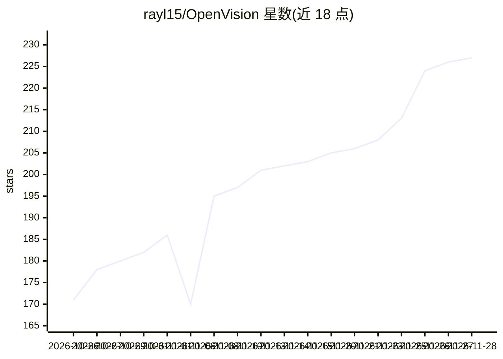

# rayl15/OpenVision

⭐ 227 · Swift · MIT · 推送 2026-11-19 · [GitHub](https://github.com/rayl15/OpenVision) · 个人维护

**开源 iOS 应用：把 Meta Ray-Ban 眼镜接入云端或本地 AI 助手**

连接 Meta Ray-Ban 智能眼镜与 AI 助手的开源 iOS 应用，提供七个可选后端：本地 MLX 模型（Qwen/Gemma/SmolVLM2）、Apple Intelligence、OpenAI、Grok、Gemini Live、OpenClaw 与自建 Hermes 服务器。支持实时语音+视频问答、离线语音合成（Kokoro）、本机人脸识别、会议转写与摘要、网页搜索和语音控制计时器/提醒等工具。蓝牙功能需实体设备与 macOS Xcode 构建。

## 筛选速览

| 维度 | 判定 | 备注 |
|---|---|---|
| AI 角色 | `ai-native` | 本体是模型或模型工具 |
| 许可风险 | `permissive` | MIT |
| 部署形态 | `None` |  |
| 模型依赖 | locked-api |  |
| 硬件要求 | — | 无带数字的原话,不猜 |
| 安装摩擦 | `medium` | 含编译或系统依赖之一 |
| 成熟度 | — | 结构信号不足 |

## 能力要点

- 七个 AI 后端可选，本地 MLX 路径零 API 成本、可离线运行
- SmolVLM2 支持完全本机的实时视频问答与拍照识别
- Apple Vision 本机人脸识别，照片不离开手机
- 会议记录本机转写（含印地语/Hinglish），由所选后端生成摘要

## 适用场景

- 戴 Ray-Ban 眼镜时语音问询所见内容并翻译菜单/路牌
- 无网络环境下用本地模型做语音助手和拍照识物
- 开会时用手机本机转写并生成带行动项的会议纪要
- 通过语音操作提醒、日历、番茄钟等效率工具

## 场景标签

`语音 Agent` `AI 助手` `人脸识别` `语音识别` · 领域:对话与助手

## 证据(README 行号)

> L5:  The open-source iOS app connecting Meta Ray-Ban smart glasses to AI assistants — cloud or fully on-device.
> L44: - **Local (MLX)**: A **choice of on-device models** via Apple MLX — Qwen 2.5 (0.5B/3B), Gemma 2 2B, Gemma 4 E2B, Sm

## 星数曲线

2026-10-26 171 → 2026-11-28 227（+56）

---
*卡片 v1 · prompt 1.4 · 生成 2026-11-25 · 置信度 high · 依据 README sha `70d1fcc1f452` · [字段定义](../../DATASET.md)*
