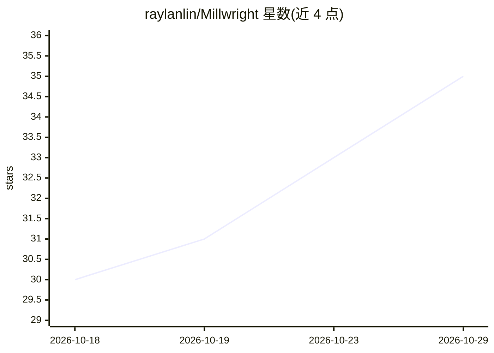

# raylanlin/Millwright

⭐ 35 · TypeScript · Apache-2.0 · 推送 2026-10-06 · [GitHub](https://github.com/raylanlin/Millwright) · 个人维护 · 中文 README

**让 AI Agent 直接操作 SolidWorks 的开源桌面工作台**

基于 Electron/React/Python 的 Windows 桌面应用：AI 通过约 50 个原生 SolidWorks 工具调用（草图、特征、装配、导出、查询）以 agent 循环方式直接驱动 CAD，每次调用返回结构化 JSON 供模型决定下一步。双引擎运行时：Python sidecar 经 COM 连接 SolidWorks，失败时回退内置 VBScript 引擎；支持截图与视觉模型反馈闭环。自带确认卡、自动备份等安全边界，安装包捆绑 Python 运行时。后端可选 Claude、GPT、DeepSeek、Kimi、Qwen、GLM 或本地 Ollama（Anthropic/OpenAI 兼容协议，BYO key）。

## 筛选速览

| 维度 | 判定 | 备注 |
|---|---|---|
| AI 角色 | `ai-native` | 本体是模型或模型工具 |
| 许可风险 | `permissive` | Apache-2.0 |
| 部署形态 | `desktop` | 安装包/桌面程序 |
| 模型依赖 | local-ok | 支持本地模型 |
| 硬件要求 | — | 无带数字的原话,不猜 |
| 安装摩擦 | `low` | 无编译、无系统依赖或容器化 |
| 成熟度 | — | 结构信号不足 |

## 能力要点

- 约 50 个原生 SolidWorks 工具调用，agent 循环自纠错，非生成宏
- 视觉反馈闭环：截图供多模态模型或独立视觉模型分析
- 跨版本自适应：运行时发现 COM 签名并动态分发
- 破坏性操作确认卡 + 自动备份，CAD 文件不出本机

## 适用场景

- 用自然语言让 AI 直接在 SolidWorks 中建模与修改零件
- 装配体操作、导出与特征树查询的自动化
- 让 AI 视觉检查建模结果并迭代修正

## 场景标签

`GUI 自动化` · 领域:效率与自动化

## 证据(README 行号)

> L9:  The open-source AI workbench that directly drives SolidWorks through native tool calling,
> L32: Millwright doesn't. It calls **~50 native SolidWorks tools directly** — sketch, feature, assembly, export, and quer
> L41: **You choose the AI backend.** Claude, GPT, DeepSeek, Kimi, MiniMax, Qwen, GLM, or a local Ollama model — anything 

## 星数曲线

2026-10-18 30 → 2026-10-29 35（+5）

---
*卡片 v1 · prompt 1.4 · 生成 2026-10-25 · 置信度 mid · 依据 README sha `cb5f6043c1a9` · [字段定义](../../DATASET.md)*
