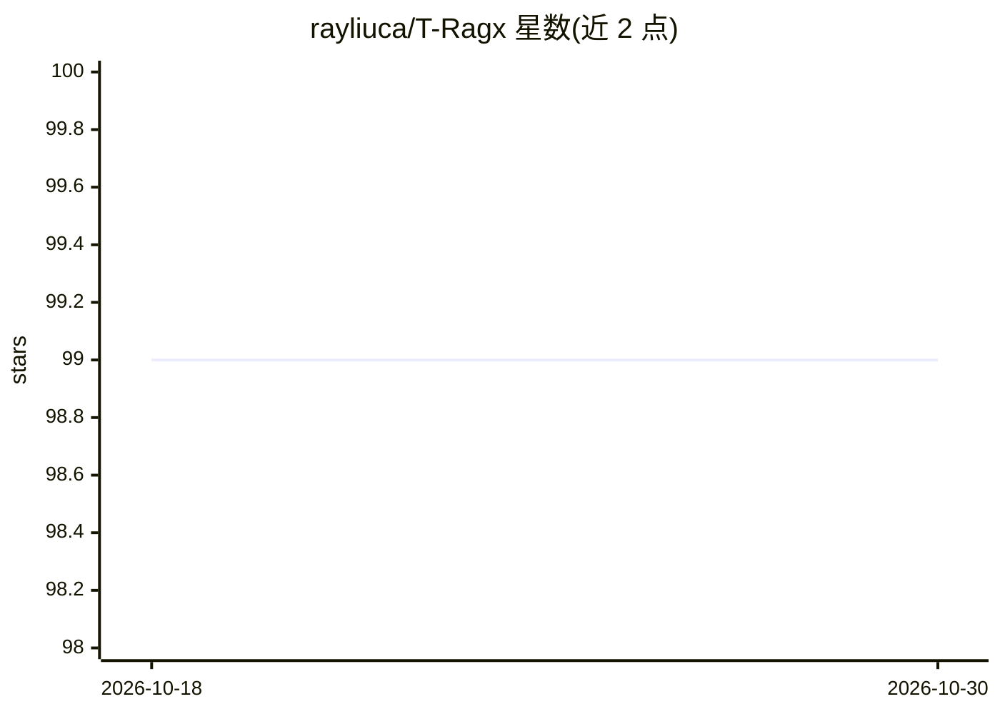

# rayliuca/T-Ragx

⭐ 99 · Python · MIT · 推送 2025-12-29 · [GitHub](https://github.com/rayliuca/T-Ragx) · [官网](https://github.com/rayliuca/T-Ragx) · 个人维护

**给译者的 RAG 增强机器翻译框架：LLM+翻译记忆产出译文**

开源系统级翻译框架，结合大语言模型与检索增强生成：从 Elasticsearch 中检索通用与任务内翻译记忆、术语表，结合前文上下文做文档级翻译，支持零样本任务内翻译，翻译过程在本地进行。提供 QLoRA 微调模型（Mistral-7B、TowerInstruct-7B 等的 LoRA/AWQ/GGUF 版本），也可通过 Ollama/OpenAI API 模型或继承 BaseModel 接入任意 LLM。以 pip 包提供，Elasticsearch 需另行部署（可访问只读预览服务，添加自有记忆需自建），附 Colab 演示。

## 筛选速览

| 维度 | 判定 | 备注 |
|---|---|---|
| AI 角色 | `ai-native` | 本体是模型或模型工具 |
| 许可风险 | `permissive` | MIT |
| 部署形态 | `library` | 以包/库形式分发 |
| 模型依赖 | local-ok | 支持本地模型 |
| 硬件要求 | — | 无带数字的原话,不猜 |
| 安装摩擦 | `low` | 无编译、无系统依赖或容器化 |
| 成熟度 | — | 结构信号不足 |

## 能力要点

- 翻译记忆+术语表+前文上下文的 RAG 检索翻译
- QLoRA 微调模型，含 AWQ/GPTQ/GGUF 量化版本
- 支持 Ollama/OpenAI API 模型或继承 BaseModel 接入任意 LLM
- 翻译过程本地进行，附 Colab 演示与只读 Elasticsearch 预览服务

## 适用场景

- 网文/文学作品的长文档翻译并保持人名术语一致
- 利用历史译稿做任务内翻译记忆提升译文质量
- 本地部署 LLM 进行隐私敏感内容的翻译

## 场景标签

`RAG` · 领域:知识与检索

## 证据(README 行号)

> L16: - Provides fluent and natural translations utilizing LLMs
> L23: - Employs both general and in-task specific translation memories and glossaries

## 星数曲线

2026-10-18 99 → 2026-10-30 99（+0）

---
*卡片 v1 · prompt 1.4 · 生成 2026-10-23 · 置信度 high · 依据 README sha `e7e76bf98200` · [字段定义](../../DATASET.md)*
