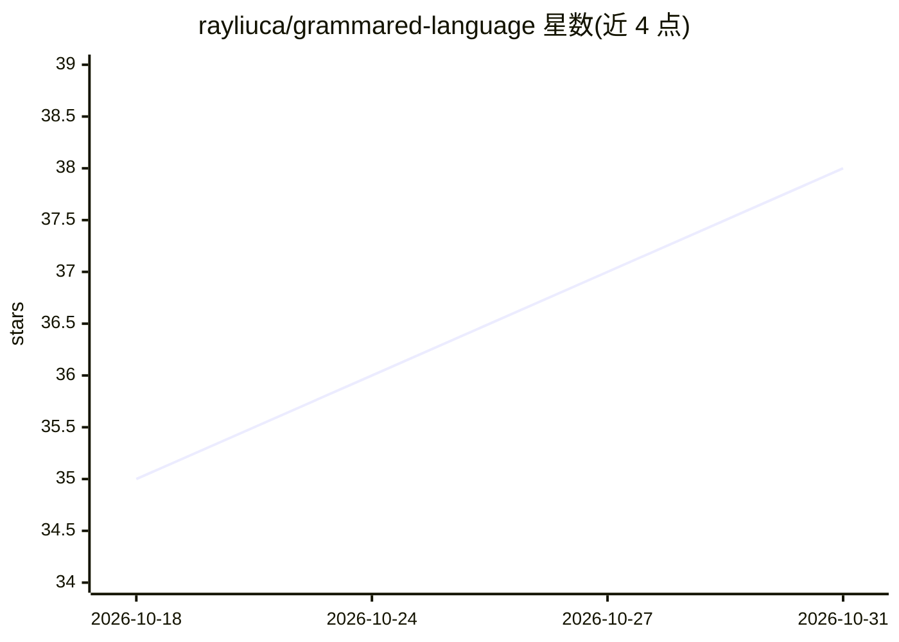

# rayliuca/grammared-language

⭐ 38 · Python · MIT · 推送 2026-04-09 · [GitHub](https://github.com/rayliuca/grammared-language) · [官网](https://github.com/rayliuca/grammared-language) · 个人维护

**把开源语法纠错模型接入 LanguageTool 的 gRPC 远程规则服务器**

作为 LanguageTool 未公开文档的远程纠错服务器（gRPC GRPCRule 通道），将开源语法纠错模型接入 LanguageTool：主要支持 Grammarly 的 GECToR 与 CoEdIT 模型，通过 Triton Inference Server 提供推理后端，模型配置支持 YAML 文件、环境变量与默认配置三级加载。用 Docker Compose 一键启动 Triton、API 与 LanguageTool。限制：所有纠错均显示为 grammar 类别、不支持改写（paraphrasing）。作者声明项目用于探索 vibe coding，代码质量可能参差。

## 筛选速览

| 维度 | 判定 | 备注 |
|---|---|---|
| AI 角色 | `ai-ecosystem` | LLM/agent 周边工具 |
| 许可风险 | `permissive` | MIT |
| 部署形态 | `self-host` | docker 或自建部署 |
| 模型依赖 | — | README 未给出锁定关系 |
| 硬件要求 | — | 无带数字的原话,不猜 |
| 安装摩擦 | `low` | 无编译、无系统依赖或容器化 |
| 成熟度 | `idea` | |

## 能力要点

- 实现 LanguageTool 的 gRPC 远程纠错服务器通道
- 支持 GECToR 与 text2text-generation（CoEdIT）类模型
- 模型配置支持 YAML/环境变量/默认文件三级加载
- Docker Compose 一键启动 Triton、API 与 LanguageTool

## 适用场景

- 让自托管 LanguageTool 使用 ML 模型做语法纠错
- 在 GECToR/CoEdIT 模型与语法检查客户端之间搭建服务
- 自托管替代闭源语法纠错服务的模型侧组件

## 场景标签

`AI 写作` · 领域:内容生成

## 证据(README 行号)

> L31: One of the most common requests is to add support for smarter, self-hosted, AI/ML-based models. While not documente
> L33: This project is that missing remote server! It connects LanguageTool to open-source grammatical error correction mo

## 星数曲线

2026-10-18 35 → 2026-10-31 38（+3）

---
*卡片 v1 · prompt 1.4 · 生成 2026-10-25 · 置信度 high · 依据 README sha `1e1de1a0fb61` · [字段定义](../../DATASET.md)*
