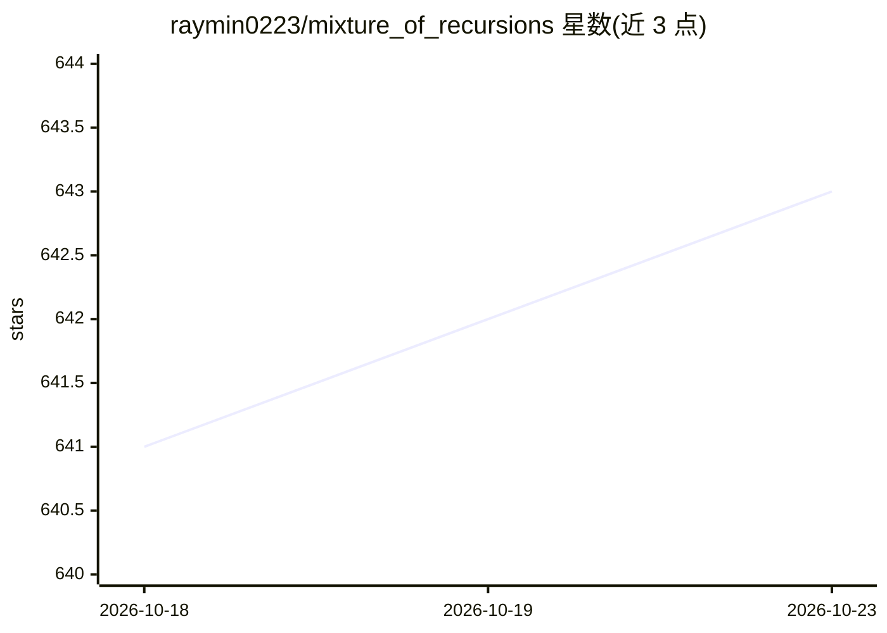

# raymin0223/mixture_of_recursions

⭐ 643 · Python · Apache-2.0 · 推送 2026-09-19 · [GitHub](https://github.com/raymin0223/mixture_of_recursions) · [官网](https://arxiv.org/abs/2507.10524) · 组织维护

**NeurIPS 2025 论文 MoR 官方代码：为 LLM 学习逐 token 的动态递归深度**

Mixture-of-Recursions 的研究代码，出自 KAIST、Mila 与 Google 系机构的研究者（NeurIPS 2025）。方法基于 Llama 架构修改 LlamaForCausalLM，通过端到端训练的路由机制（expert-choice 与 token-choice 两种实现）为每个 token 分配递归深度，并以按递归粒度的 KV 缓存策略解决早退 token 缺失 KV 的问题。报告在相近精度下推理吞吐最高达标准 transformer 的 2 倍。提供基于 FineWeb-Edu 去重子集的预训练流程、lm-evaluation-harness 少样本评测、360M 参数的 Vanilla/Recursive/MoR 预训练检查点及路由行为分析 notebook；训练通常使用 4 张 H100/A100，分布式依赖 DeepSpeed 或 Accelerate。

## 筛选速览

| 维度 | 判定 | 备注 |
|---|---|---|
| AI 角色 | `ai-native` | 本体是模型或模型工具 |
| 许可风险 | `permissive` | Apache-2.0 |
| 部署形态 | `library` | 以包/库形式分发 |
| 模型依赖 | — | README 未给出锁定关系 |
| 硬件要求 | — | 无带数字的原话,不猜 |
| 安装摩擦 | `medium` | 含编译或系统依赖之一 |
| 成熟度 | — | 结构信号不足 |

## 能力要点

- 基于 Llama 架构实现 expert-choice 与 token-choice 两种路由，逐 token 分配递归深度
- 递归粒度 KV 缓存策略，选择性存储 KV 对
- 提供预训练/少样本评测配置生成脚本与合并脚本（DeepSpeed/Accelerate）
- 共享 360M 参数 Vanilla/Recursive/MoR 预训练检查点（Google Drive）

## 适用场景

- 复现 MoR 论文的预训练与少样本评测实验
- 研究早退与参数共享类自适应计算架构
- 分析模型的路由决策行为（提供 notebook）

## 场景标签

`模型训练` · 领域:训练与推理

## 证据(README 行号)

> L24: Our new research **[MoR]** introduces a **unified framework** that directly tackles both the missing KV cache and b
> L94: Our models are built upon the Llama architecture, specifically by modifying the LlamaForCausalLM class.
> L132: We typically conducted training using 4 H100 or A100 GPUs. For distributed training, we leveraged either `Accelera

## 星数曲线

2026-10-18 641 → 2026-10-23 643（+2）

---
*卡片 v1 · prompt 1.4 · 生成 2026-10-22 · 置信度 mid · 依据 README sha `c5657a27b3d9` · [字段定义](../../DATASET.md)*
