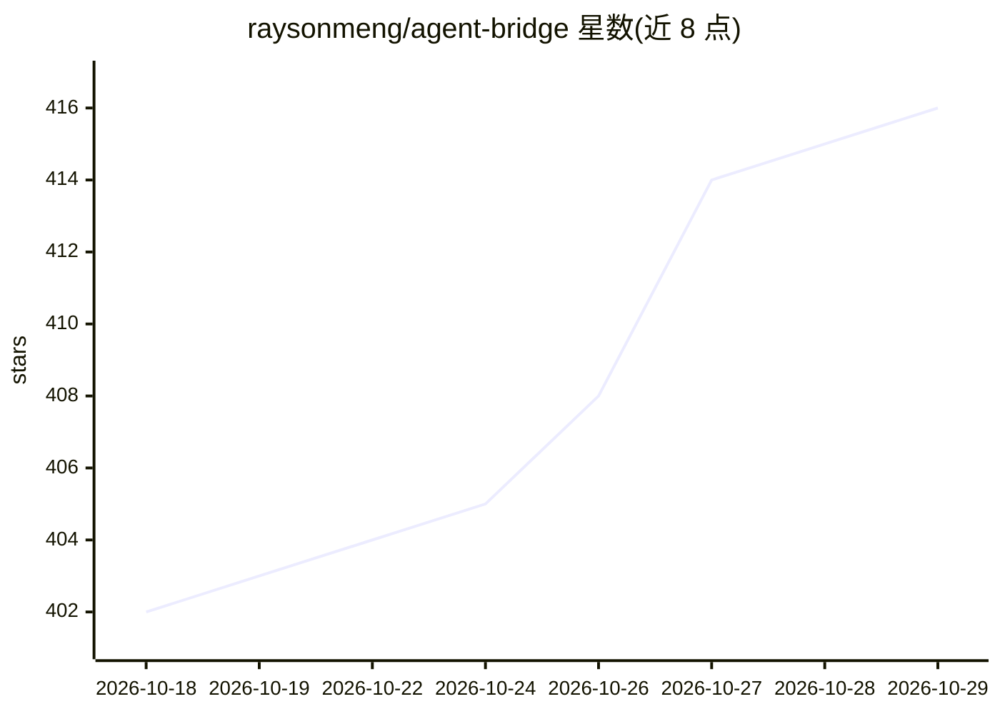

# raysonmeng/agent-bridge

⭐ 416 · TypeScript · MIT · 推送 2026-10-27 · [GitHub](https://github.com/raysonmeng/agent-bridge) · [官网](https://raysonmeng.github.io/agent-bridge/) · 个人维护 · 中文 README

**让 Claude Code 与 Codex 在同一会话双向协作的本地桥接工具**

本地优先的开发者工具，通过常驻守护进程在 MCP 通道与 Codex app-server 协议间转发消息，使 Claude Code 与 Codex 作为持久对等端在同一个工作会话中互发消息、互相审查 diff、协商任务分工，并在一方订阅额度耗尽时在回合边界交接任务以维持长任务运行。桥接只传递消息而非上下文，采用三级标记路由（IMPORTANT/STATUS/FYI）控制上下文增长。以 Bun 为运行时，提供 abg CLI 管理守护进程、配额快照与诊断；默认以跳过权限模式启动两个 agent，属实验性人机协同设置，非托管服务或通用编排框架。

## 筛选速览

| 维度 | 判定 | 备注 |
|---|---|---|
| AI 角色 | `ai-ecosystem` | LLM/agent 周边工具 |
| 许可风险 | `permissive` | MIT |
| 部署形态 | `library` | 以包/库形式分发 |
| 模型依赖 | locked-api |  |
| 硬件要求 | — | 无带数字的原话,不猜 |
| 安装摩擦 | `low` | 无编译、无系统依赖或容器化 |
| 成熟度 | `idea` | |

## 能力要点

- MCP 通道与 Codex app-server 协议间的双向消息转发
- 三级标记路由（IMPORTANT/STATUS/FYI）只传递消息不合并上下文
- busy-guard 回合协调与订阅额度耗尽时的任务交接
- 多对 Claude+Codex 并行（每项目目录一对，端口从 4500 递增）

## 适用场景

- 让两个 agent 在同一会话内互相审查代码改动而无需人工传递
- 从单一提示出发让两个 agent 协商任务分工并各自实现
- 跨订阅额度窗口的长任务接力执行
- 同时管理多对 Claude/Codex 协作实例并诊断运行状态

## 场景标签

`多智能体` · 领域:Agent 开发

## 证据(README 行号)

> L41: - A local developer tool for connecting Claude Code and Codex in one workflow
> L42: - A bridge that forwards messages between an MCP channel and the Codex app-server protocol

## 星数曲线

2026-10-18 402 → 2026-10-29 416（+14）

---
*卡片 v1 · prompt 1.4 · 生成 2026-10-21 · 置信度 mid · 依据 README sha `c55fb2935e65` · [字段定义](../../DATASET.md)*
