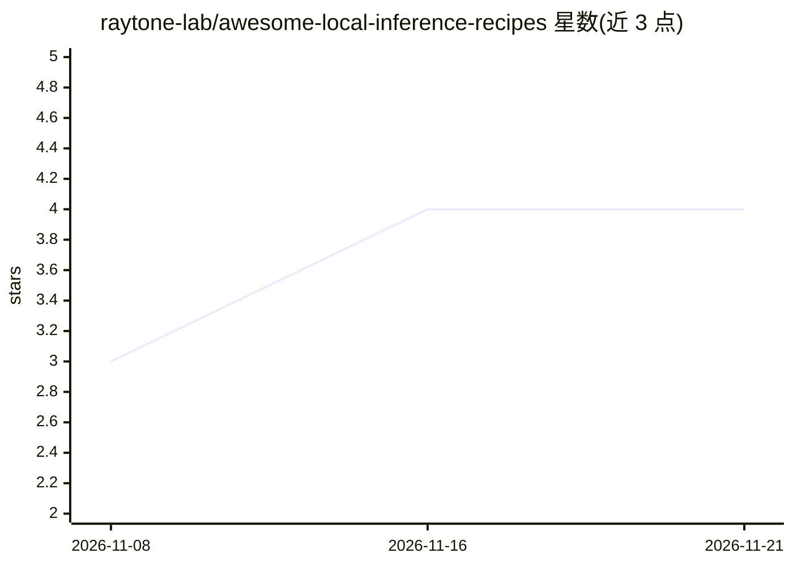

# raytone-lab/awesome-local-inference-recipes

⭐ 4 · HTML · MIT · 推送 2026-11-20 · [GitHub](https://github.com/raytone-lab/awesome-local-inference-recipes) · [官网](https://raytone-lab.github.io/awesome-local-inference-recipes/) · 组织维护 · 中文 README

**本地 AI 推理速度实测数据集：模型×引擎×硬件的来源可查清单**

收录 1021 条本地推理配方（974 文本 · 21 图像 · 26 视频音频），覆盖 6 个硬件家族、130 个引擎、17 个模型家族，预算上限 3 万美元。每条 tok/s 数据附来源链接与信任等级（官方/实测/转述/宣称）。范围限定个人、家庭/办公室桌面或小工作室可搭建的配置，明确排除数据中心方案；提供范围校验脚本、按硬件/模型家族/引擎的浏览表及在线 explorer。数据以 MIT 与 CC BY 4.0 双重方式发布，README 提供英/中/日三语版本。

## 筛选速览

| 维度 | 判定 | 备注 |
|---|---|---|
| AI 角色 | `ai-knowledge` | 知识聚合/清单类 |
| 许可风险 | `permissive` | MIT |
| 部署形态 | `None` |  |
| 模型依赖 | — | README 未给出锁定关系 |
| 硬件要求 | — | 无带数字的原话,不猜 |
| 安装摩擦 | `medium` | 含编译或系统依赖之一 |
| 成熟度 | — | 结构信号不足 |

## 能力要点

- 1021 条配方，每条数据链接来源并标注四级信任等级
- 覆盖 Mac、RTX、DGX Spark、AMD 等 6 个硬件家族与 130 个引擎
- 范围规则限定 ≤$30k、≤4 台机器、普通家用供电，并附 scope_rules.py 校验脚本
- MIT 与 CC BY 4.0 许可，三语 README

## 适用场景

- 购卡前查我的 RTX 5090 跑本地模型大概多少 tok/s
- 对比不同推理引擎在同一硬件上的实测速度
- 按预算（如 $2,500 以内）找最快的本地部署方案

## 场景标签

`模型评测` `精选清单` · 领域:评测与运维

## 证据(README 行号)

> L19: **1021 recipes** (974 text · 21 image · 26 video & audio) · **6 hardware families** · **130 engines** · **17 model 
> L47: This list is for setups that one person, a home or office desktop user, or a small studio can build. Datacenter set
> L7:  1021 recipes data as of 2026-11-20 validate MIT CC BY 4.0 GitHub stars PRs welcome

## 星数曲线

2026-11-08 3 → 2026-11-21 4（+1）

---
*卡片 v1 · prompt 1.4 · 生成 2026-11-21 · 置信度 high · 依据 README sha `9fe6419c308f` · [字段定义](../../DATASET.md)*
