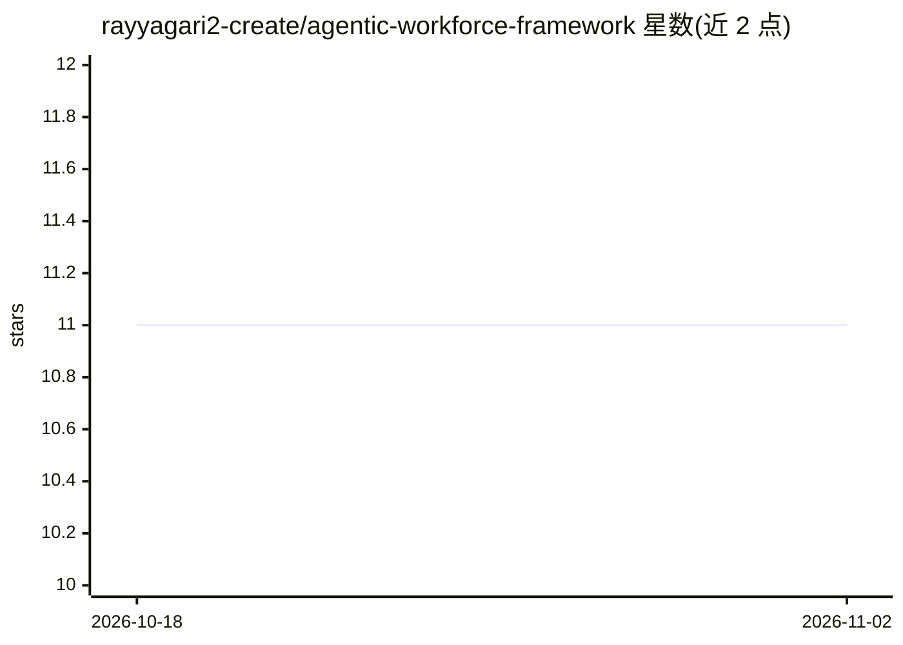

# rayyagari2-create/agentic-workforce-framework

⭐ 11 · JavaScript · MIT · 推送 2026-05-30 · [GitHub](https://github.com/rayyagari2-create/agentic-workforce-framework) · 个人维护

**AI 编码 agent 团队的治理层：风险分级、信任评分与审计**

位于 AI 编码 agent 运行时之上的授权治理框架：对任务按五个维度分级进入风险通道，依据运行时已获信任层级决定授权、监管或拦截，执行后从真实工件按 D1-D4（正确性/可观测性/合规/复发）维度评分，并写入哈希链防篡改审计日志。提供 JSON Schema（AJV Draft 2020-12 兼容）、授权 CLI demo 与跨运行时（Claude Code/Codex）治理示例。需 Node.js 18+ 与 PostgreSQL，不生成代码、不路由子 agent。指标为自报且未经独立审计。

## 筛选速览

| 维度 | 判定 | 备注 |
|---|---|---|
| AI 角色 | `ai-ecosystem` | LLM/agent 周边工具 |
| 许可风险 | `permissive` | MIT |
| 部署形态 | `library` | 以包/库形式分发 |
| 模型依赖 | — | README 未给出锁定关系 |
| 硬件要求 | — | 无带数字的原话,不猜 |
| 安装摩擦 | `low` | 无编译、无系统依赖或容器化 |
| 成熟度 | — | 结构信号不足 |

## 能力要点

- 任务五阶段流程：分级→授权→执行→评分→哈希链审计验证
- 信任分层（PROVISIONAL/RESTRICTED/STANDARD/HIGH）与 D1-D4 评分
- 跨 Claude Code 与 Codex 的单控制面治理
- 17 类失效分类的 FailureRecord 等 JSON Schema 体系

## 适用场景

- 对 agent 执行的高风险任务（如 DB 迁移）设置审批门
- 跨多个编码 agent 运行时统一授权与审计
- 按信任证据决定运行时是否被授权、监管或拦截

## 场景标签

`LLM 可观测性` · 领域:评测与运维

## 证据(README 行号)

> L5: TrustPlane is the authority layer above AI coding agents.
> L32: TrustPlane blocks, authorizes or supervises a runtime based

## 星数曲线

2026-10-18 11 → 2026-11-02 11（+0）

---
*卡片 v1 · prompt 1.4 · 生成 2026-11-01 · 置信度 high · 依据 README sha `ec2b59b79364` · [字段定义](../../DATASET.md)*
