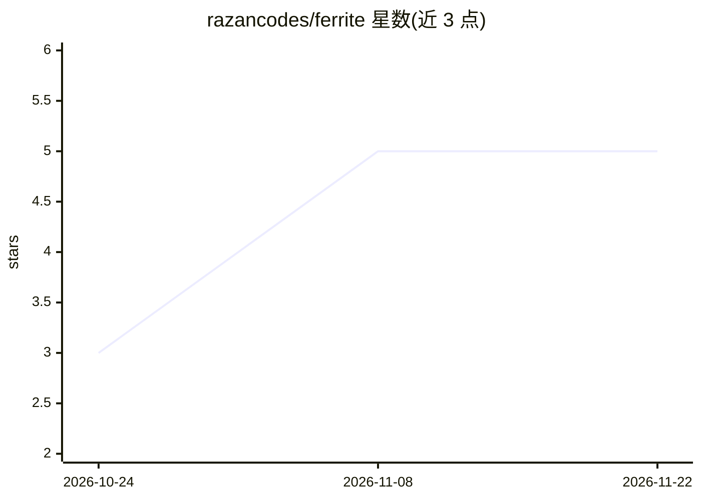

# razancodes/ferrite

⭐ 5 · Rust · MIT · 推送 2026-10-07 · [GitHub](https://github.com/razancodes/ferrite) · 个人维护

**Rust 编写的 Qwen3.5 CPU 推理引擎，面向无 GPU 笔记本**

为 Qwen3.5 系列（DeltaNet+attention 混合架构）专门编写的 Rust 推理引擎：自带 tokenizer、safetensors 读取、量化、AVX-512 内核、推测解码、chat 模板，并提供 OpenAI 兼容 API 服务器与 Tauri 桌面聊天应用。无底层 ML 框架，依赖列表短。目标用户是在普通 x86 笔记本上本地运行小模型的开发者。限制：仅支持 Qwen3.5 架构、仅 x86（快速路径需 AVX-512 VNNI）、仅文本、基准来自单一测试机。

## 筛选速览

| 维度 | 判定 | 备注 |
|---|---|---|
| AI 角色 | `ai-ecosystem` | LLM/agent 周边工具 |
| 许可风险 | `permissive` | MIT |
| 部署形态 | `None` |  |
| 模型依赖 | local-ok | 支持本地模型 |
| 硬件要求 | — | 无带数字的原话,不猜 |
| 安装摩擦 | `medium` | 含编译或系统依赖之一 |
| 成熟度 | — | 结构信号不足 |

## 能力要点

- 针对单一模型家族的专用引擎，自行实现 tokenizer/量化/内核/采样全链路
- 利用 Qwen3.5 的 MTP 头做推测解码，并实现 DeltaNet 缓存回滚
- 提供 OpenAI 兼容 API 服务器（含 web chat）与 Tauri 桌面聊天应用
- 以困惑度与 token 一致性对齐 Hugging Face transformers 参考实现

## 适用场景

- 在没有 GPU 的 x86 笔记本上本地运行 Qwen3.5 0.8b–4b 模型
- 通过 OpenAI 兼容 API 把本地模型接入已有工具链
- 需要确定性对照基准时复现 docs/benchmarks.md 中的测试

## 场景标签

`推理引擎` `模型量化` · 领域:训练与推理

## 证据(README 行号)

> L28: general-purpose engines support this design as one of hundreds. i wanted to see what happens when
> L37: - an openai-compatible server and a desktop chat app.
> L159: ./target/release/ferrite serve -m models/qwen3.5-2b-q8.ferrite

## 星数曲线

2026-10-24 3 → 2026-11-22 5（+2）

---
*卡片 v1 · prompt 1.4 · 生成 2026-11-21 · 置信度 high · 依据 README sha `901d39dde60c` · [字段定义](../../DATASET.md)*
