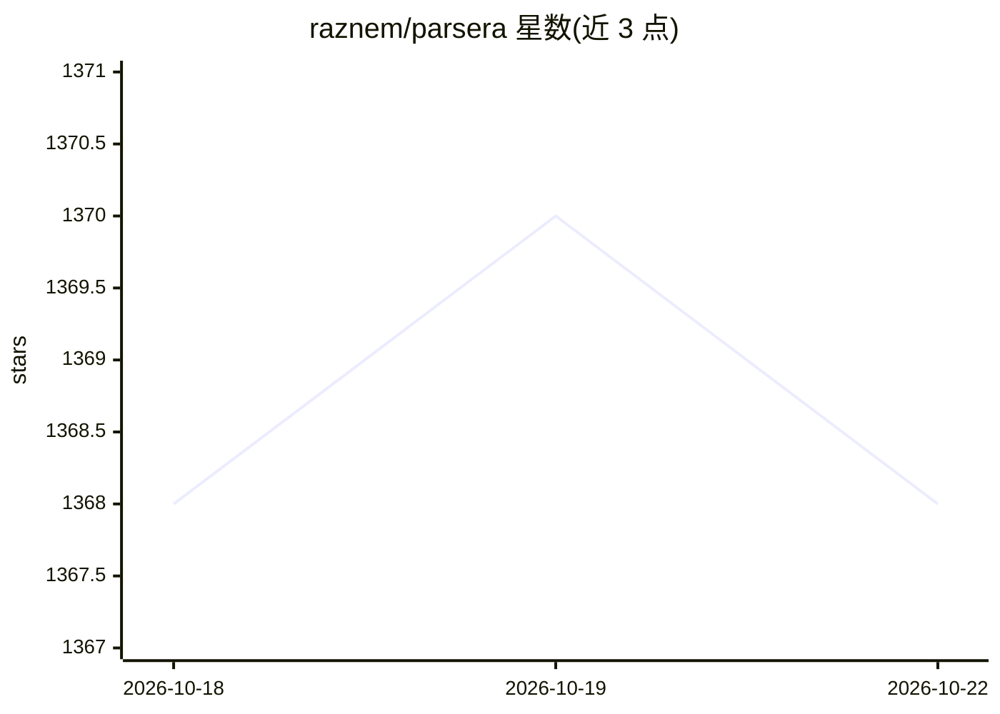

# raznem/parsera

⭐ 1,370 · Python · GPL-2.0 · 推送 2025-12-17 · [GitHub](https://github.com/raznem/parsera) · [官网](https://docs.parsera.org) · 组织维护

**用 LLM 抓取并结构化提取网页数据的轻量 Python 库**

Parsera 是一个轻量级 Python 网页抓取库：通过 Playwright 加载页面，借助 LLM 按用户定义的元素 schema 提取结构化 JSON 数据，接口仅需 Parsera().run(url, elements)。默认通过 PARSERA_API_KEY 调用云端服务，也支持运行自定义 LLM 模型；另提供 CLI（python -m parsera.main）、异步 arun 方法与 Docker 运行方式，Jupyter 中需 nest_asyncio。面向需要从网页提取结构化数据的开发者。

## 筛选速览

| 维度 | 判定 | 备注 |
|---|---|---|
| AI 角色 | `ai-native` | 本体是模型或模型工具 |
| 许可风险 | `viral` | GPL-2.0 |
| 部署形态 | `library` | 以包/库形式分发 |
| 模型依赖 | — | README 未给出锁定关系 |
| 硬件要求 | — | 无带数字的原话,不猜 |
| 安装摩擦 | `low` | 无编译、无系统依赖或容器化 |
| 成熟度 | — | 结构信号不足 |

## 能力要点

- LLM 驱动的网页元素结构化提取，输出 JSON 记录
- 支持自定义模型运行与 Playwright 脚本
- 提供同步/异步 API、CLI 与 Docker 运行方式

## 适用场景

- 从任意网页按需提取标题、链接等结构化字段
- 在脚本或 Jupyter 中批量抓取并整理网页数据

## 场景标签

`网页抓取` · 领域:效率与自动化

## 证据(README 行号)

> L6: Lightweight Python library for scraping websites with LLMs.
> L27: Check out documentation to learn more about other features, like running custom models and playwright scripts.

## 星数曲线

2026-10-18 1,368 → 2026-10-22 1,368（+0）

---
*卡片 v1 · prompt 1.4 · 生成 2026-10-21 · 置信度 high · 依据 README sha `49485e531b2b` · [字段定义](../../DATASET.md)*
