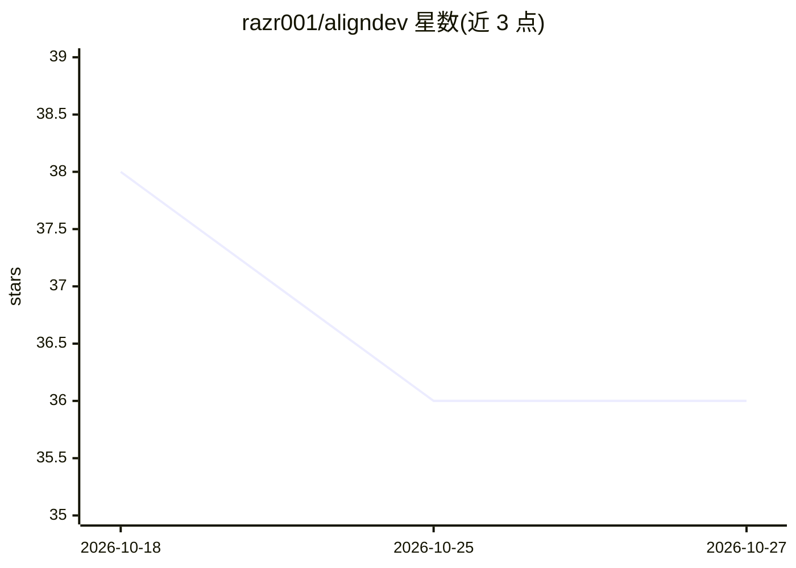

# razr001/aligndev

⭐ 36 · TypeScript · 推送 2026-06-25 · [GitHub](https://github.com/razr001/aligndev) · [官网](https://aligndev.dev) · 个人维护

**前端团队规范生成器：7 步向导产出规范文档与 SKILL.md**

面向使用多个 AI 编程 agent 的前端团队的 Next.js 网页工具：通过 7 步可视化向导（技术栈/UI/状态/工具链/目录/命名/Design Tokens）生成完整 Markdown 规范文档和可放在仓库根目录、供 Claude Code、Cursor、Copilot 等 agent 读取的 SKILL.md。支持 Next.js/React/Vue/Nuxt/SvelteKit 五种框架、49 种 UI 风格、WCAG 对比度检查、npm 版本实时同步与 i18n/RTL。README 未给出安装运行命令。

## 筛选速览

| 维度 | 判定 | 备注 |
|---|---|---|
| AI 角色 | `ai-ecosystem` | LLM/agent 周边工具 |
| 许可风险 | `none` | — |
| 部署形态 | `None` |  |
| 模型依赖 | — | README 未给出锁定关系 |
| 硬件要求 | — | 无带数字的原话,不猜 |
| 安装摩擦 | `low` | 无编译、无系统依赖或容器化 |
| 成熟度 | — | 结构信号不足 |

## 能力要点

- 7 步向导生成规范文档与 SKILL.md 两种产物
- 支持 Next.js/React/Vue/Nuxt/SvelteKit 五类框架
- 49 种 UI 风格与 Design Tokens 实时预览导出
- WCAG 对比度自动检查（AA/AAA）

## 适用场景

- 为团队生成统一的前端编码规范文档
- 产出 SKILL.md 让多个 AI 编程 agent 遵循同一套约定
- 选定 UI 风格并导出 Design Tokens

## 场景标签

`代码生成` · 领域:编码与开发

## 证据(README 行号)

> L7: A 7-step visual wizard that generates a complete Markdown standards document and a `SKILL.md` that Claude Code, Curs
> L21: When teams use Claude Code, Cursor, Copilot, Windsurf, and other AI agents at the same time, the biggest pain point
> L39: |🤖 **AI-agent friendly**|Output optimized for Claude Skill / Cursor Rules|Drop it into your repo and agents can fol

## 星数曲线

2026-10-18 38 → 2026-10-27 36（-2）

---
*卡片 v1 · prompt 1.4 · 生成 2026-10-25 · 置信度 high · 依据 README sha `47c7d34ee8c0` · [字段定义](../../DATASET.md)*
