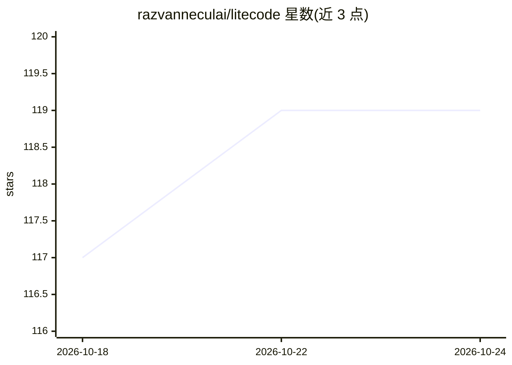

# razvanneculai/litecode

⭐ 119 · TypeScript · ISC · 推送 2026-04-28 · [GitHub](https://github.com/razvanneculai/litecode) · 个人维护

**面向 8k 上下文模型的 CLI AI 编码代理**

Node.js CLI/TUI 编码代理，让开发者用自然语言指令在项目中执行多文件修改。针对免费层与本地模型的 8k 上下文限制设计：每次 LLM 调用前在代码层强制执行 token 预算，采用规划-执行三阶段流程，一次只向模型发送单文件内容；用三层 Markdown 上下文地图（项目/文件夹/文件索引）描述项目结构。支持 Ollama、LM Studio、Groq、OpenRouter、Gemini、DeepSeek 等 OpenAI 兼容端点，提供 4 条记录的短期记忆、并行编辑、diff 预览与 In+React 构建的 TUI。通过 git clone 源码安装，需 Node.js v18+。

## 筛选速览

| 维度 | 判定 | 备注 |
|---|---|---|
| AI 角色 | `ai-native` | 本体是模型或模型工具 |
| 许可风险 | `permissive` | ISC |
| 部署形态 | `library` | 以包/库形式分发 |
| 模型依赖 | local-ok | 支持本地模型 |
| 硬件要求 | — | 无带数字的原话,不猜 |
| 安装摩擦 | `low` | 无编译、无系统依赖或容器化 |
| 成熟度 | — | 结构信号不足 |

## 能力要点

- 每次 LLM 调用前代码级强制 token 预算，支持 8k 上下文模型
- 三层 Markdown 上下文地图（项目/文件夹/行级索引）描述项目
- 多文件编辑：独立任务并行执行，本地 provider 自动串行
- 短期记忆（4 条环形缓冲）支持 undo/继续类指令，每次写入前 diff 预览

## 适用场景

- 用免费层或本地模型（Ollama/LM Studio）做跨文件代码修改
- 在 8k 上下文限制下让 AI 理解并编辑整个项目
- 通过 TUI 会话持续对项目做增量修改与撤销

## 场景标签

`编码 Agent` · 领域:编码与开发

## 证据(README 行号)

> L3: > The AI coding agent built for the models everyone actually has — free tiers, local models, and 8k context windows.
> L167: litecode "add error handling to the fetchUser function"

## 星数曲线

2026-10-18 117 → 2026-10-24 119（+2）

---
*卡片 v1 · prompt 1.4 · 生成 2026-10-23 · 置信度 high · 依据 README sha `6457d6cccd7e` · [字段定义](../../DATASET.md)*
