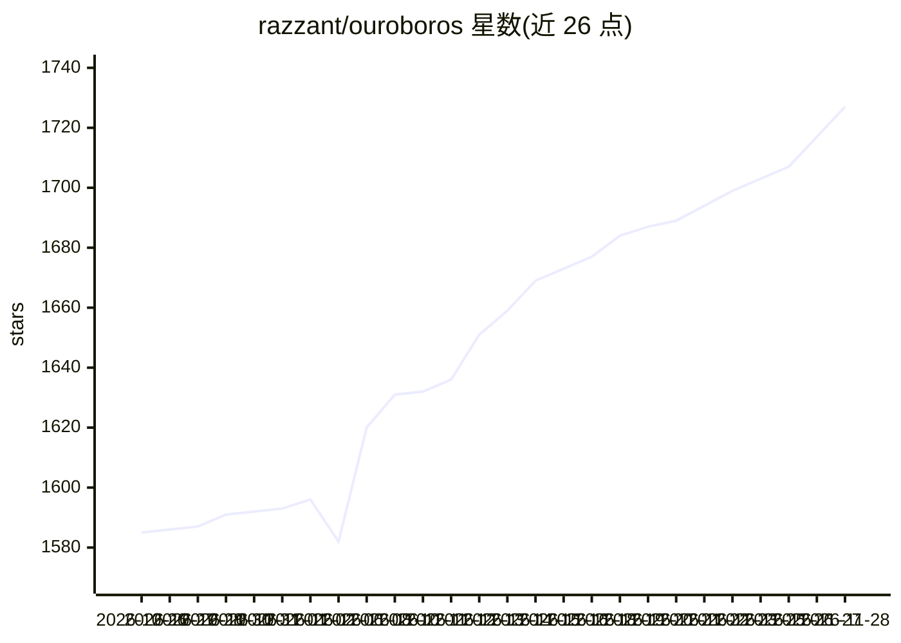

# razzant/ouroboros

⭐ 1,727 · Python · MIT · 推送 2026-11-27 · [GitHub](https://github.com/razzant/ouroboros) · [官网](https://ouroboros-agent.ai/) · 个人维护

**跨任务持续记忆与自我演化的通用桌面 AI 代理**

开源通用 AI 代理，以桌面应用或无头 CLI 运行，跨任务与重启保持身份、持久记忆与历史。可在外部项目上工作、协调专家代理集群，并重写自身代码、架构、提示与依赖。推理可用配置的远程 API 或本地 GGUF 模型；仓库、记忆与界面留在本机，默认不发送遥测。内置花费限额（总计 $200/单任务 $50/后台意识每 24 小时 $15）。提供 macOS/Windows/Linux 安装包与 Homebrew 安装方式。

## 筛选速览

| 维度 | 判定 | 备注 |
|---|---|---|
| AI 角色 | `ai-native` | 本体是模型或模型工具 |
| 许可风险 | `permissive` | MIT |
| 部署形态 | `desktop` | 安装包/桌面程序 |
| 模型依赖 | local-ok | 支持本地模型 |
| 硬件要求 | — | 无带数字的原话,不猜 |
| 安装摩擦 | `low` | 无编译、无系统依赖或容器化 |
| 成熟度 | `idea` | |

## 能力要点

- 持久记忆与身份跨任务、跨重启延续
- 可重写自身代码、架构、提示、工具与依赖，并有独立代理审查流程
- 支持远程 API 或本地 GGUF 模型推理，默认无遥测
- 内置支出限额与首启向导（模型、预算、技能配置）

## 适用场景

- 让代理在外部代码项目上执行编码与审查任务
- 管理一个持续运行的专家代理集群
- 本地保留代理记忆与执行历史、不外发遥测

## 场景标签

`AI 助手` `编码 Agent` `多智能体` `GUI 自动化` · 领域:Agent 开发

## 证据(README 行号)

> L18: Ouroboros is an open-source, general-purpose AI agent whose identity, durable memory, and history continue across t
> L82: To run tasks, choose a connected Codex account as the Main model source, configure a supported remote provider API 
> L121: Ouroboros first booted on February 16, 2026. During the following 48 hours, the repository advanced from the v4.1 

## 星数曲线

2026-10-26 1,585 → 2026-11-28 1,727（+142）

---
*卡片 v1 · prompt 1.4 · 生成 2026-11-27 · 置信度 mid · 依据 README sha `75bd12949fd2` · [字段定义](../../DATASET.md)*
