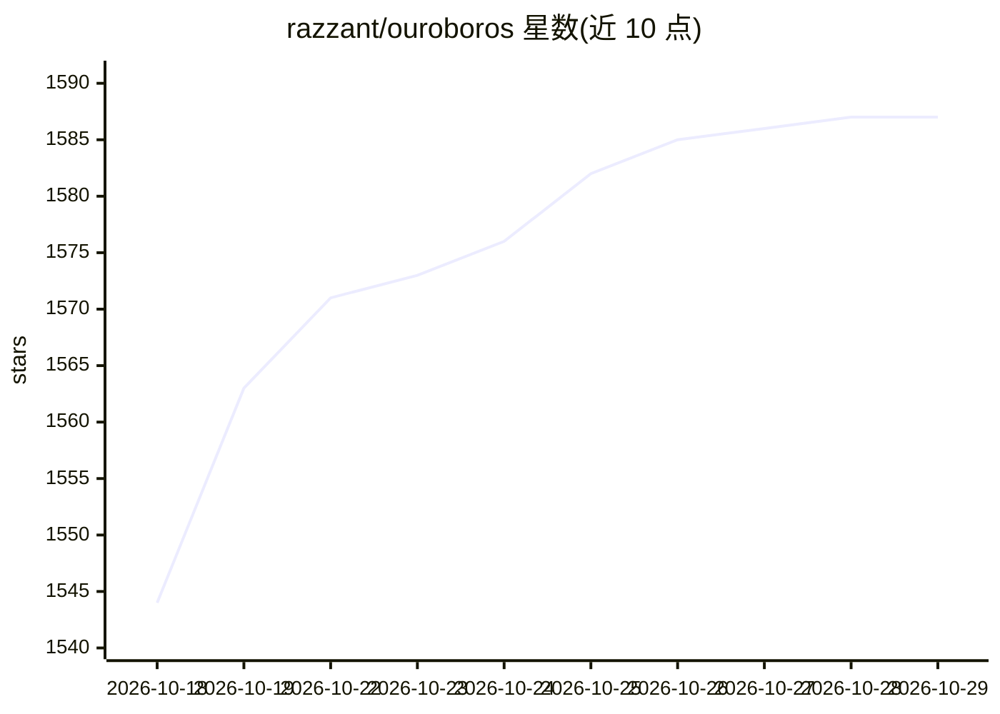

# razzant/ouroboros

⭐ 1,587 · Python · MIT · 推送 2026-10-28 · [GitHub](https://github.com/razzant/ouroboros) · [官网](https://ouroboros-agent.ai/) · 个人维护 · 中文 README

**开源通用自进化 AI agent，跨任务持续身份与记忆**

以原生桌面应用或 headless CLI 形式运行的通用 AI agent：跨任务与重启保持身份、持久记忆与历史；可修改自身运行的代码、架构、提示词、工具与依赖，自变更通过 Git 历史与审查证据保持可追踪。支持并行专家 agent 群协作、外部项目工作区、后台反思。模型推理可配置远程 provider API 或本地 GGUF 模型，桌面安装包内捆绑可选 CLI 安装器。基准结果为自报口径。

## 筛选速览

| 维度 | 判定 | 备注 |
|---|---|---|
| AI 角色 | `ai-native` | 本体是模型或模型工具 |
| 许可风险 | `permissive` | MIT |
| 部署形态 | `desktop` | 安装包/桌面程序 |
| 模型依赖 | local-ok | 支持本地模型 |
| 硬件要求 | — | 无带数字的原话,不猜 |
| 安装摩擦 | `low` | 无编译、无系统依赖或容器化 |
| 成熟度 | `idea` | |

## 能力要点

- 跨任务与重启持续的身份、记忆与历史（自述传记机制）
- 可重写自身代码、架构、提示词与依赖，变更入 Git 历史并可审查
- 专家 agent 群并行协作与外部项目工作区
- 支持远程 provider API 或本地 GGUF 模型填充认知角色

## 适用场景

- 作为常驻桌面 agent 处理跨会话的长期项目
- 通过 CLI/headless 方式运行受管理的自动化任务
- 观察一个自我修改实现且变更留有 Git 证据的 agent 系统

## 场景标签

`多智能体` `GUI 自动化` `Agent 记忆` · 领域:Agent 开发

## 证据(README 行号)

> L17: Ouroboros is an open-source, general-purpose AI agent whose identity, durable memory, and history continue across t
> L91: - **Modify its implementation.** Its editable surface spans application code, architecture, prompts, tools, and dep
> L94: - **Think between requests.** Background consciousness supports reflection, initiative, and preparation outside the

## 星数曲线

2026-10-18 1,544 → 2026-10-29 1,587（+43）

---
*卡片 v1 · prompt 1.4 · 生成 2026-10-21 · 置信度 high · 依据 README sha `87cf8174c49d` · [字段定义](../../DATASET.md)*
