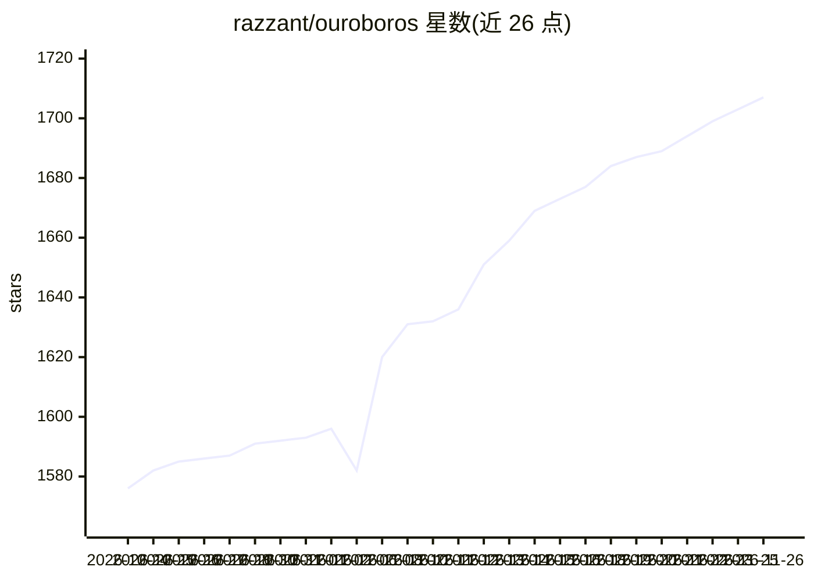

# razzant/ouroboros

⭐ 1,707 · Python · MIT · 推送 2026-11-25 · [GitHub](https://github.com/razzant/ouroboros) · [官网](https://ouroboros-agent.ai/) · 组织维护

**跨任务保持记忆与身份的通用自主桌面 AI agent**

开源通用 AI agent，以桌面应用或无头 CLI 运行：仓库、持久记忆、历史与界面保留在本地机器上，模型推理走用户配置的远程 API 或本地 GGUF 模型。支持协调多个专家 agent 的 swarm、委托编码与审查（捆绑 Claudexor 执行层）、浏览器与计算机操作工具，并能在审查流程约束下改写自身代码、提示词与依赖。默认不发送遥测，内置 $200/$50/$20 三档支出限额，首个运行向导配置模型访问、审查策略与预算。提供技术报告与 Terminal-Bench 2.1、OSWorld-Verified 等自报告基准图表。

## 筛选速览

| 维度 | 判定 | 备注 |
|---|---|---|
| AI 角色 | `ai-native` | 本体是模型或模型工具 |
| 许可风险 | `permissive` | MIT |
| 部署形态 | `desktop` | 安装包/桌面程序 |
| 模型依赖 | local-ok | 支持本地模型 |
| 硬件要求 | — | 无带数字的原话,不猜 |
| 安装摩擦 | `low` | 无编译、无系统依赖或容器化 |
| 成熟度 | `idea` | |

## 能力要点

- 持久记忆与身份跨任务、跨重启延续
- 可改写自身实现（代码/架构/提示词/工具），须经 CONTRIBUTING 定义的独立 agent 审查流程
- 默认无遥测，本地历史留在机器上
- 内置支出限额与后台意识（background consciousness）24 小时 $20 预算

## 适用场景

- 在本地桌面以一个持续记忆的 agent 处理跨任务工作
- 委托编码任务并让独立 agent 做审查
- 用本地 GGUF 模型离线运行 agent
- 协调多个专家 agent 分工完成外部项目

## 场景标签

`多智能体` `编码 Agent` `GUI 自动化` `Agent 记忆` · 领域:Agent 开发

## 证据(README 行号)

> L18: Ouroboros is an open-source, general-purpose AI agent whose identity, durable memory, and history continue across t
> L20: It runs as a native desktop app or through a headless CLI. The runtime keeps its repository, durable memory, histor
> L82: To run tasks, choose a connected Codex account as the Main model source, configure a supported remote provider API 

## 星数曲线

2026-10-24 1,576 → 2026-11-26 1,707（+131）

---
*卡片 v1 · prompt 1.4 · 生成 2026-11-23 · 置信度 low · 依据 README sha `444619920d6d` · [字段定义](../../DATASET.md)*
