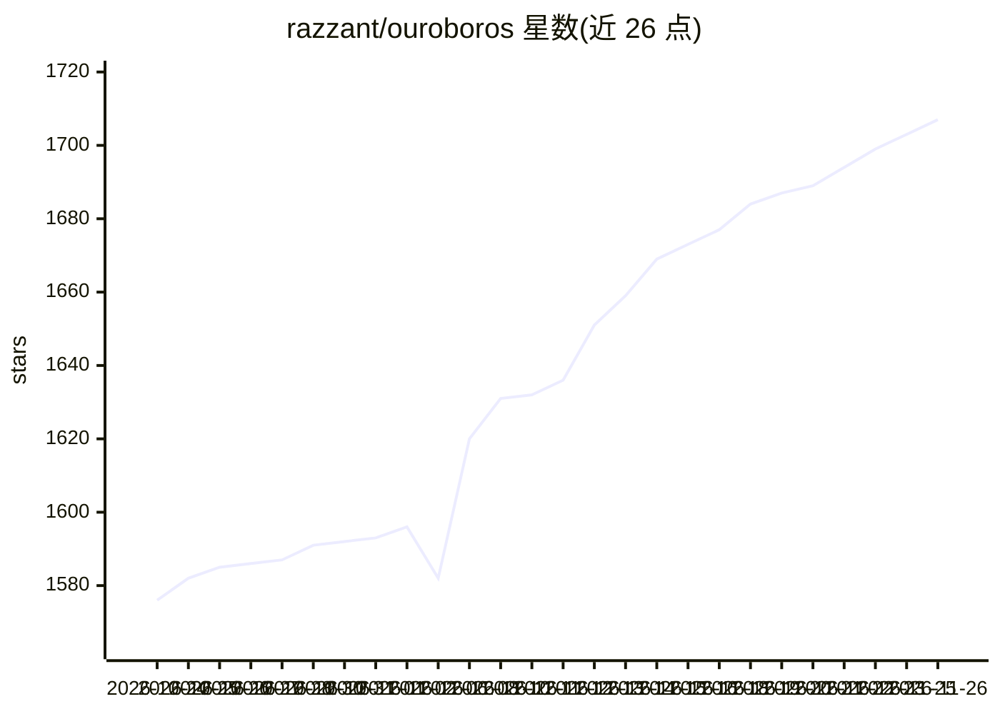

# razzant/ouroboros

⭐ 1,707 · Python · MIT · 推送 2026-11-25 · [GitHub](https://github.com/razzant/ouroboros) · [官网](https://ouroboros-agent.ai/) · 组织维护

**跨任务保留身份与记忆的通用自主 AI agent**

开源通用 AI agent，跨任务与重启保持身份、持久记忆和历史。可在外部项目上工作、协调多个专家 agent 的集群，并能重写自身运行的代码、架构、提示词与依赖。以桌面应用或无头 CLI 运行，仓库、记忆与界面在本地，模型推理可走远程 API 或本地 GGUF 模型。默认不发送遥测，内置支出限额（总计 $200、单任务 $50、后台意识每 24 小时 $15），首启向导引导账户、模型与预算配置。

## 筛选速览

| 维度 | 判定 | 备注 |
|---|---|---|
| AI 角色 | `ai-native` | 本体是模型或模型工具 |
| 许可风险 | `permissive` | MIT |
| 部署形态 | `desktop` | 安装包/桌面程序 |
| 模型依赖 | local-ok | 支持本地模型 |
| 硬件要求 | — | 无带数字的原话,不猜 |
| 安装摩擦 | `low` | 无编译、无系统依赖或容器化 |
| 成熟度 | — | 结构信号不足 |

## 能力要点

- 跨任务与重启保留身份、持久记忆与历史的 agent
- 可自我重写运行的代码、架构、提示词、工具与依赖
- 桌面应用与无头 CLI 双形态，本地 GGUF 或远程 API 推理
- 内置支出限额与默认无遥测的数据本地化设计

## 适用场景

- 让 agent 在外部项目上自主执行编码与审查任务
- 通过桌面应用运行并管理多个专家 agent 的协作
- 在本地以 GGUF 模型运行不依赖远程 API 的 agent

## 场景标签

`多智能体` `编码 Agent` `Agent 记忆` · 领域:Agent 开发

## 证据(README 行号)

> L18: Ouroboros is an open-source, general-purpose AI agent whose identity, durable memory, and history continue across t
> L20: It runs as a native desktop app or through a headless CLI. The runtime keeps its repository, durable memory, histor
> L82: To run tasks, choose a connected Codex account as the Main model source, configure a supported remote provider API 

## 星数曲线

2026-10-24 1,576 → 2026-11-26 1,707（+131）

---
*卡片 v1 · prompt 1.4 · 生成 2026-11-26 · 置信度 mid · 依据 README sha `0bce07796526` · [字段定义](../../DATASET.md)*
