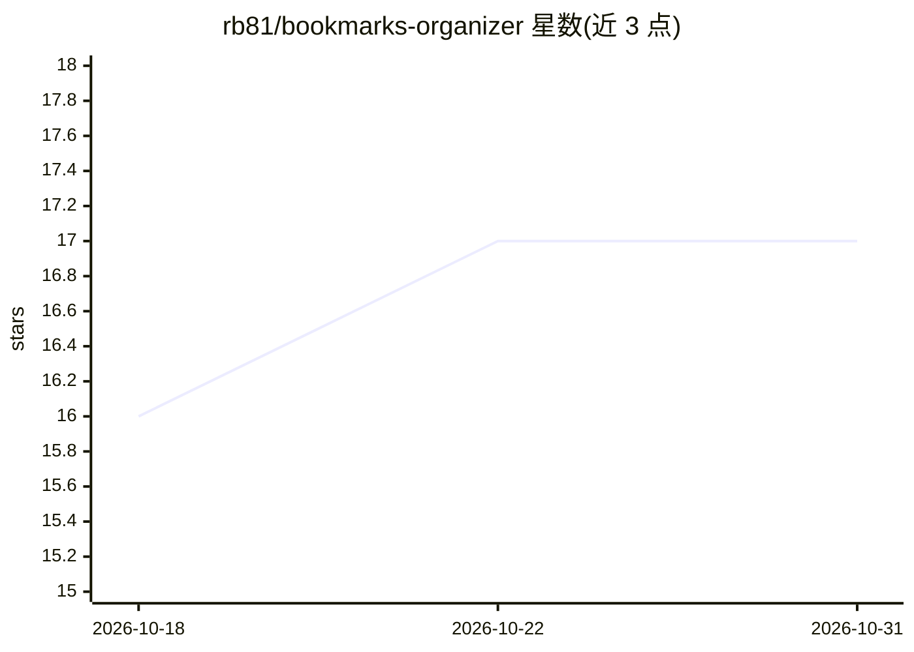

# rb81/bookmarks-organizer

⭐ 17 · Python · MIT · 推送 2026-06-15 · [GitHub](https://github.com/rb81/bookmarks-organizer) · 个人维护

**用 LLM 给浏览器书签自动分类并重新导出的 CLI 工具**

读取浏览器导出的 Netscape 格式书签 HTML 文件，调用任意 OpenAI 兼容 API（OpenAI、OpenRouter、LM Studio、Ollama 等，需支持结构化 JSON 输出）对书签进行分类，再导出为可导回浏览器的文件。支持保护指定文件夹不被改动、仅整理未分类书签、批量处理、中断后自动保存进度并续跑，对限流/超时等瞬时错误按退避重试。以 Python 源码形式提供，配置通过环境变量与 config.yaml 完成。

## 筛选速览

| 维度 | 判定 | 备注 |
|---|---|---|
| AI 角色 | `ai-native` | 本体是模型或模型工具 |
| 许可风险 | `permissive` | MIT |
| 部署形态 | `None` |  |
| 模型依赖 | local-ok | 支持本地模型 |
| 硬件要求 | — | 无带数字的原话,不猜 |
| 安装摩擦 | `low` | 无编译、无系统依赖或容器化 |
| 成熟度 | — | 结构信号不足 |

## 能力要点

- 解析并导出标准 Netscape 书签格式（兼容 Chrome/Firefox/Safari/Edge）
- 任意 OpenAI 兼容 LLM 分类，需模型支持 json_object 结构化输出
- 保护文件夹、仅整理未分类书签、进度保存与断点续跑
- 限流/超时/5xx 等瞬时错误按退避重试，失败书签归入 Uncategorized

## 适用场景

- 把多年积累的杂乱浏览器书签自动归类成文件夹
- 只整理新增书签而不打乱已有分类结构
- 配合本地 Ollama/LM Studio 离线整理书签

## 场景标签

 · 领域:个人数据管理/浏览器工具

## 证据(README 行号)

> L5: AI-powered bookmark organizer that reads your exported bookmarks (Netscape format), categorizes them into folders us
> L10: - **AI categorization** using OpenAI, OpenRouter, or any OpenAI-compatible API

## 星数曲线

2026-10-18 16 → 2026-10-31 17（+1）

---
*卡片 v1 · prompt 1.4 · 生成 2026-10-29 · 置信度 high · 依据 README sha `f314c755a212` · [字段定义](../../DATASET.md)*
