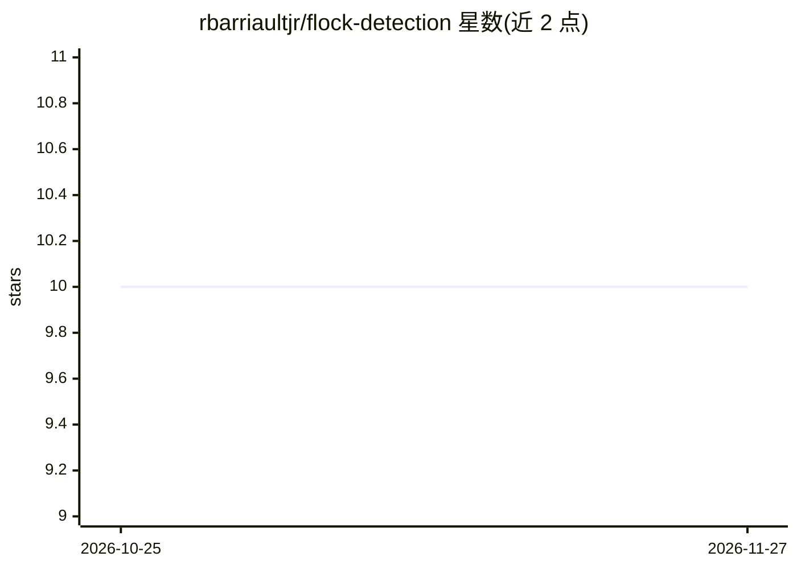

# rbarriaultjr/flock-detection

⭐ 10 · C++ · 推送 2026-10-12 · [GitHub](https://github.com/rbarriaultjr/flock-detection) · 个人维护

**在 ESP32-S3 上检测周边监控设备的固件，GPS 记录供隐私审计**

运行于 ESP32-S3 微控制器的检测工具：扫描周边 WiFi 与蓝牙信号，识别 Flock Safety ALPR 摄像头与 Raven 枪声检测器的设备特征，对检测结果给出置信度评分，并连同 GPS 位置写入 CSV 文件，可选通过外接 OLED 屏显示摘要。面向希望在本地运行、排查特定监控设备的个人用户；提供 Windows 下的烧录流程说明，固件从 Releases 或项目页 ZIP 下载后用 ESP 烧录工具刷入。

## 筛选速览

| 维度 | 判定 | 备注 |
|---|---|---|
| AI 角色 | `ai-native` | 本体是模型或模型工具 |
| 许可风险 | `none` | — |
| 部署形态 | `None` |  |
| 模型依赖 | — | README 未给出锁定关系 |
| 硬件要求 | — | 无带数字的原话,不猜 |
| 安装摩擦 | `low` | 无编译、无系统依赖或容器化 |
| 成熟度 | — | 结构信号不足 |

## 能力要点

- 扫描 WiFi 与 BLE 信号识别 Flock ALPR 摄像头与 Raven 枪声检测器
- 对检测结果输出置信度评分
- 带 GPS 位置的 CSV 记录，可导出并在地图应用中标注
- 可选 OLED 屏实时显示检测摘要

## 适用场景

- 出行或居住区域排查周边是否有 ALPR 摄像头等监控设备
- 将带 GPS 的检测记录导入地图应用做设备分布标注
- 配合信息公开或隐私审计留存检测日志

## 场景标签

`网络安全` · 领域:学习与行业

## 证据(README 行号)

> L7: flock-detection is a tool that helps you find certain surveillance devices around you. It works with an ESP32-S3 mic
> L82: - It identifies Flock Safety ALPR cameras and Raven gunshot detectors by recognizing their device signals.

## 星数曲线

2026-10-25 10 → 2026-11-27 10（+0）

---
*卡片 v1 · prompt 1.4 · 生成 2026-11-19 · 置信度 mid · 依据 README sha `abfcde23e167` · [字段定义](../../DATASET.md)*
