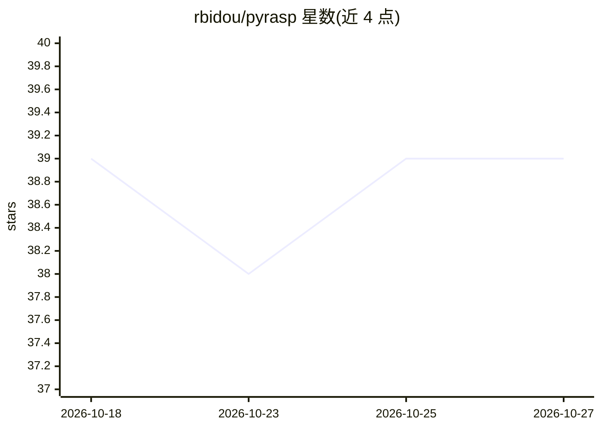

# rbidou/pyrasp

⭐ 39 · Python · NOASSERTION · 推送 2026-10-25 · [GitHub](https://github.com/rbidou/pyrasp) · [官网](https://pyrasp.paracyberbellum.io) · 个人维护

**Python Web 与 MCP 服务器的运行时自防护（RASP）安全包**

PyRASP 是面向 Python Web 框架（Flask、FastAPI、Django）、Serverless 函数与 MCP 服务器（FastMCP）的运行时应用自防护包，从应用内部防护 Web 应用常见攻击。提供 CPU/内存等基础遥测，并实现 Zero-Trust Application Access 限制仅授权且最新的浏览器连接。AI 方面：防护 MCP 服务器工具免受恶意输入注入与数据泄露（PII、凭据），防护 LLM 前端免受提示注入。检测不依赖签名，结合诱饵、阈值、系统/应用内部状态与机器学习。注意：自 0.8.3 起不再支持 AWS Lambda。

## 筛选速览

| 维度 | 判定 | 备注 |
|---|---|---|
| AI 角色 | `ai-enhanced` | 去掉 AI 部分产品仍成立 |
| 许可风险 | `none` | NOASSERTION |
| 部署形态 | `None` |  |
| 模型依赖 | — | README 未给出锁定关系 |
| 硬件要求 | — | 无带数字的原话,不猜 |
| 安装摩擦 | `low` | 无编译、无系统依赖或容器化 |
| 成熟度 | — | 结构信号不足 |

## 能力要点

- 应用内 RASP 防护，覆盖 Flask/FastAPI/Django、Serverless 与 FastMCP
- MCP 工具输入注入与数据泄露（PII/凭据）防护及 LLM 提示注入防护
- Zero-Trust Application Access 与基础遥测（CPU/内存/请求数）
- 无签名检测：基于诱饵、阈值、系统内部状态与机器学习

## 适用场景

- 为 FastAPI/Flask/Django 应用添加运行时自防护
- 保护 MCP 服务器工具免受输入注入与数据泄露
- 通过零信任访问控制限制关键应用的浏览器连接

## 场景标签

`网络安全` · 领域:学习与行业

## 证据(README 行号)

> L10: `PyRASP` is a **Runtime Application Self Protection** package for Python-based Web Servers (Flask, FastAPI and Djan
> L12: `PyRASP` provides full agentic AI security by protecting MCP servers tools from malicious inputs injections and dat

## 星数曲线

2026-10-18 39 → 2026-10-27 39（+0）

---
*卡片 v1 · prompt 1.4 · 生成 2026-10-25 · 置信度 mid · 依据 README sha `e12c3f69f9dc` · [字段定义](../../DATASET.md)*
