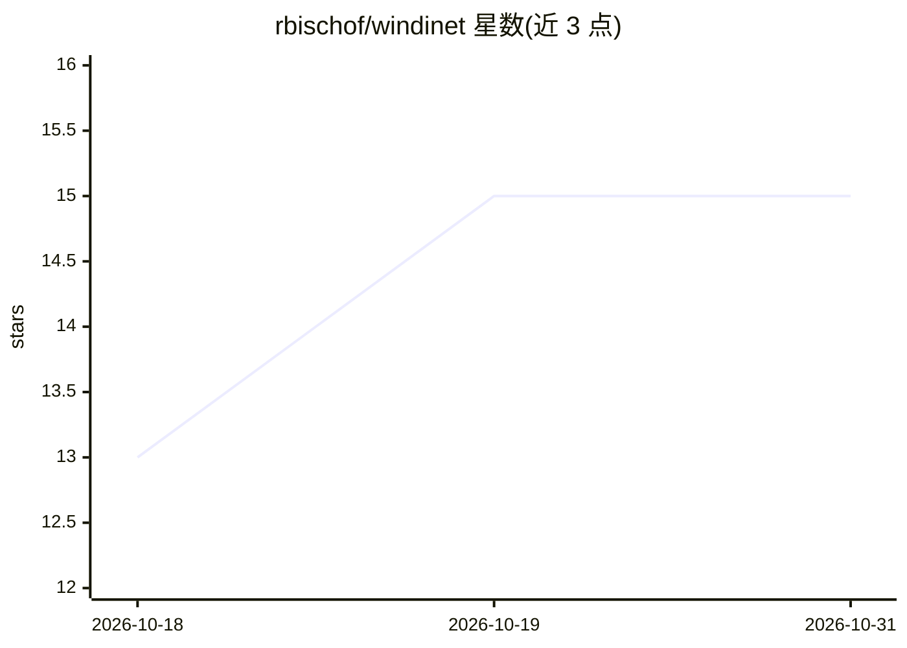

# rbischof/windinet

⭐ 15 · Python · Apache-2.0 · 推送 2026-04-15 · [GitHub](https://github.com/rbischof/windinet) · [官网](https://rbischof.github.io/windinet_web/) · 个人维护

**用视频扩散模型替代 CFD，秒级生成城市风流场仿真**

WinDiNet 将 LTX-Video 视频扩散 Transformer 微调为 CFD 的可微替代模型：在 10,000 个 CFD 仿真数据上训练，输入建筑足迹图与入口风速等标量条件，生成 112 帧速度场 rollout（秒级完成），输出 npz 与 mp4。提供两阶段训练流程（物理信息损失微调 VAE 解码器 + 标量条件扩散训练）、指标评估脚本，以及以模型为可微替代器优化建筑布局的逆设计框架（行人风舒适度损失）。面向需要快速风流仿真与建筑布局优化的科研/工程用户，训练需 CUDA GPU（推荐 48GB 显存）。

## 筛选速览

| 维度 | 判定 | 备注 |
|---|---|---|
| AI 角色 | `ai-native` | 本体是模型或模型工具 |
| 许可风险 | `permissive` | Apache-2.0 |
| 部署形态 | `library` | 以包/库形式分发 |
| 模型依赖 | — | README 未给出锁定关系 |
| 硬件要求 | `gpu-24g` | |
| 安装摩擦 | `medium` | 含编译或系统依赖之一 |
| 成熟度 | — | 结构信号不足 |

## 能力要点

- 视频扩散模型微调为可微 CFD 替代器，1 秒内生成 112 帧速度场
- 物理信息损失（不可压缩性、墙壁无穿透边界）微调 VAE 解码器
- 逆设计框架可优化建筑布局以改善行人风舒适度
- 预训练权重托管于 HuggingFace，首次运行自动下载

## 适用场景

- 快速生成城市建筑风流场仿真，替代耗时的 CFD 计算
- 优化建筑布局以减少危险或不舒适的风环境
- 用自定义数据集微调或重新训练模型

## 场景标签

`科研工具` `微调` · 领域:学习与行业

## 证据(README 行号)

> L13: WinDiNet repurposes the LTX-Video video diffusion transformer as a fast, differentiable surrogate for computational
> L17: **Prerequisites:** Python 3.10+, CUDA-capable GPU (48 GB VRAM recommended for training).

## 星数曲线

2026-10-18 13 → 2026-10-31 15（+2）

---
*卡片 v1 · prompt 1.4 · 生成 2026-10-30 · 置信度 high · 依据 README sha `c32b87ba8568` · [字段定义](../../DATASET.md)*
