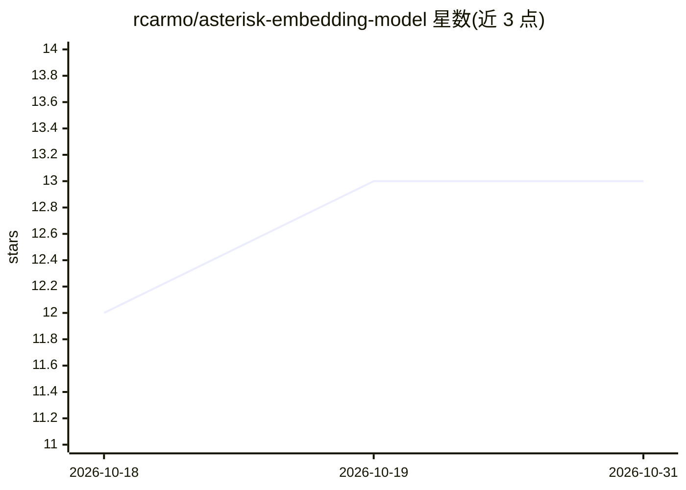

# rcarmo/asterisk-embedding-model

⭐ 13 · Python · MIT · 推送 2026-01-10 · [GitHub](https://github.com/rcarmo/asterisk-embedding-model) · 个人维护

**面向低资源硬件的 256 维轻量文本嵌入模型**

基于 Transformer 编码器的小型句子嵌入模型（2 层、2 注意力头、约 260 万参数），输出 256 维嵌入，磁盘占用约 30MB，支持 INT8 量化 ONNX 用于 CPU 部署。在 NEWSROOM 数据集（约 130 万文章-摘要对）上训练，支持从 teacher 模型（默认 all-MiniLM-L6-v2）知识蒸馏。作者场景为 CPU 上对数千条新闻摘要做语义搜索（目标延迟低于 50ms）及个人笔记聚类去重。以 Python 源码与 make 流水线提供训练/量化/推理脚本。

## 筛选速览

| 维度 | 判定 | 备注 |
|---|---|---|
| AI 角色 | `ai-native` | 本体是模型或模型工具 |
| 许可风险 | `permissive` | MIT |
| 部署形态 | `None` |  |
| 模型依赖 | — | README 未给出锁定关系 |
| 硬件要求 | — | 无带数字的原话,不猜 |
| 安装摩擦 | `medium` | 含编译或系统依赖之一 |
| 成熟度 | `idea` | |

## 能力要点

- 约 260 万参数、256 维输出、约 30MB 磁盘占用
- INT8 量化 ONNX 支持 CPU 部署，PyTorch 与 ONNX Runtime 两种推理路径
- 支持从 teacher 模型（all-MiniLM-L6-v2）知识蒸馏训练
- 训练流水线采用行偏移索引、内存映射等内存效率设计

## 适用场景

- 在没有 GPU 的设备上对数千条文本做语义搜索
- 对个人笔记和博客文章做聚类或去重
- 在消费级硬件（如 12GB 显卡）上快速训练定制嵌入模型

## 场景标签

`语义搜索` · 领域:知识与检索

## 证据(README 行号)

> L5: A compact, efficient 256-dimensional text embedding model based on a Transformer encoder.
> L28: Asterisk is a lightweight sentence embedding model designed for:
> L30: - **Fast inference**: INT8 quantized ONNX for CPU deployment

## 星数曲线

2026-10-18 12 → 2026-10-31 13（+1）

---
*卡片 v1 · prompt 1.4 · 生成 2026-10-31 · 置信度 high · 依据 README sha `aa8f0aaac9e5` · [字段定义](../../DATASET.md)*
