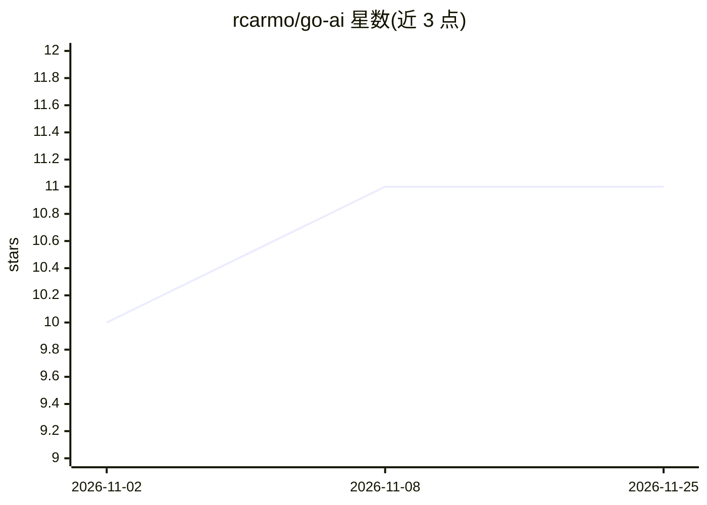

# rcarmo/go-ai

⭐ 11 · Go · MIT · 推送 2026-11-23 · [GitHub](https://github.com/rcarmo/go-ai) · 个人维护

**Go 语言的统一推理 API 库：多模型提供商接入与流式调用**

earendil-works/pi-ai TypeScript 库的 Go 移植，对齐其 v1.4.0 基线并推进 v1.5.0（pi-ai、pi-durable、pi-codemode），以纯 Go（CGO_ENABLED=0）实现。提供统一的 Stream/Complete 入口、流式事件通道、JSON Schema 工具调用、推理/思考输出、模型注册表、OAuth 辅助，以及基于 SQLite 的持久化会话/任务/恢复 harness。供 Go 开发者在应用中接入多家模型 API。需 Go 1.26+，代码示例集中在 examples 目录。

## 筛选速览

| 维度 | 判定 | 备注 |
|---|---|---|
| AI 角色 | `ai-ecosystem` | LLM/agent 周边工具 |
| 许可风险 | `permissive` | MIT |
| 部署形态 | `None` |  |
| 模型依赖 | locked-api |  |
| 硬件要求 | — | 无带数字的原话,不猜 |
| 安装摩擦 | `low` | 无编译、无系统依赖或容器化 |
| 成熟度 | `idea` | |

## 能力要点

- 统一 Stream/Complete 入口，通道式文本/思考/工具调用事件
- 多提供商实现：OpenAI 兼容、Anthropic、Gemini、Mistral、Bedrock、Copilot、Cloudflare 等
- OAuth 辅助覆盖 GitHub Copilot、Codex、Anthropic、Gemini CLI、Kimi Coding、xAI 等
- SQLite 持久化 harness：任务、工具、订阅、压缩与恢复，无 CGO 依赖

## 适用场景

- 在 Go 服务中统一接入多家 LLM API 并处理流式输出
- 实现带工具调用与推理输出的 agent/会话
- 跨 Go 与 TypeScript 在制品间迁移消息与 agent 状态
- 需要无 CGO、可复现构建的模型推理集成

## 场景标签

`模型网关` · 领域:Agent 开发

## 证据(README 行号)

> L10: A Go port of `@earendil-works/pi-ai` with the same broad shape: model discovery, streaming events, tool calls, OAut
> L23: * One `Stream`/`Complete` entry point over the registered provider implementation, with channel-based text, thinkin
> L89: The generated catalog also includes provider metadata for OpenRouter, xAI, Groq, Cerebras, Vercel AI Gateway, Firew

## 星数曲线

2026-11-02 10 → 2026-11-25 11（+1）

---
*卡片 v1 · prompt 1.4 · 生成 2026-11-18 · 置信度 high · 依据 README sha `219a499ca875` · [字段定义](../../DATASET.md)*
