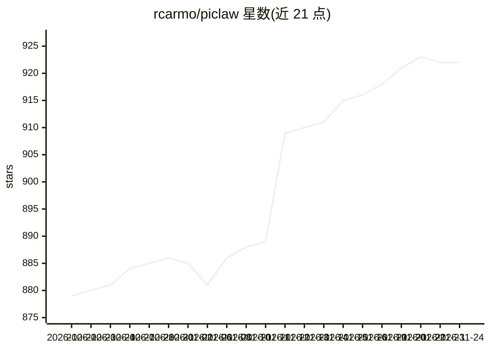

# rcarmo/piclaw

⭐ 922 · TypeScript · MIT · 推送 2026-11-23 · [GitHub](https://github.com/rcarmo/piclaw) · [官网](https://rcarmo.github.io/projects/piclaw/) · 个人维护

**自托管的单用户 AI 工作区，基于 Pi Coding Agent**

PiClaw 将 Pi Coding Agent 封装为可通过浏览器访问的自托管工作区：用户在同一窗口中与 agent 对话、编辑工作区文件、运行命令并查看结果。会话、文件与定时任务跨访问持久化（SQLite 存储与文件式 Dream memory），模型请求发送到用户自行配置的 provider，含本地 OpenAI 兼容服务器。支持流式聊天、模型切换、MCP 服务器、技能扩展与 VNC 远程显示面板；默认单用户，无内建多账户，需自行配置浏览器认证与 HTTPS。提供 Docker、便携版、Bun 与源码四种安装方式。

## 筛选速览

| 维度 | 判定 | 备注 |
|---|---|---|
| AI 角色 | `ai-ecosystem` | LLM/agent 周边工具 |
| 许可风险 | `permissive` | MIT |
| 部署形态 | `self-host` | docker 或自建部署 |
| 模型依赖 | — | README 未给出锁定关系 |
| 硬件要求 | — | 无带数字的原话,不猜 |
| 安装摩擦 | `low` | 无编译、无系统依赖或容器化 |
| 成熟度 | — | 结构信号不足 |

## 能力要点

- 单窗口内完成对话、文件编辑、命令运行与结果查看（CSV/PDF/图像/视频/代码查看器）
- 会话、文件与定时任务持久化，含可搜索聊天历史与文件式 Dream memory
- 支持 Skills、MCP 服务器、浏览器自动化等扩展工作流
- Web UI 支持英/简中/日三语，含桌面与移动端布局

## 适用场景

- 在浏览器中通过 coding agent 管理个人工作区文件与任务
- 接入本地 OpenAI 兼容模型服务器进行离线自托管使用
- 通过定时任务与持久化会话延续跨日工作流

## 场景标签

`编码 Agent` `AI 助手` · 领域:编码与开发

## 证据(README 行号)

> L7: PiClaw is a self-hosted AI workspace, single-user by default, built on the Pi Coding Agent. Work with an agent, edit
> L49: |Work with an agent|Streaming chat, model selection, live steering, queued follow-ups, separate conversations and `
> L55: The web UI guide and tools and skills reference cover the controls and commands. Local model setup is documented in

## 星数曲线

2026-10-22 879 → 2026-11-24 922（+43）

---
*卡片 v1 · prompt 1.4 · 生成 2026-11-24 · 置信度 high · 依据 README sha `fff2de0575d8` · [字段定义](../../DATASET.md)*
