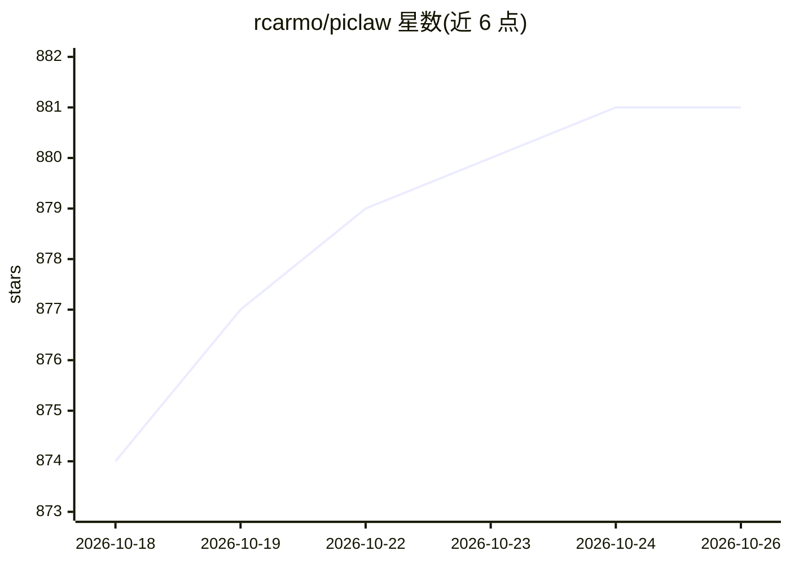

# rcarmo/piclaw

⭐ 881 · TypeScript · MIT · 推送 2026-10-25 · [GitHub](https://github.com/rcarmo/piclaw) · [官网](https://rcarmo.github.io/projects/piclaw/) · 个人维护 · 中文 README

**自托管单用户 AI 编码工作区：浏览器内对话、编辑与执行**

基于 Pi Coding Agent 构建的自托管 Web AI 工作区，默认单用户。在浏览器同一窗口内与 agent 对话、编辑工作区文件、运行命令并查看结果（表格/PDF/图片/视频查看器、VNC 远程显示面板）。对话、文件与定时任务跨访问持久化；模型请求发送到用户配置的 provider，包括本地 OpenAI 兼容服务器。提供 Docker、便携发行版、Bun 仓库安装与源码构建四种方式；Web UI 支持英文、简体中文与日语。新实例默认无网页登录门，需自行配置认证与 HTTPS。

## 筛选速览

| 维度 | 判定 | 备注 |
|---|---|---|
| AI 角色 | `ai-ecosystem` | LLM/agent 周边工具 |
| 许可风险 | `permissive` | MIT |
| 部署形态 | `self-host` | docker 或自建部署 |
| 模型依赖 | — | README 未给出锁定关系 |
| 硬件要求 | — | 无带数字的原话,不猜 |
| 安装摩擦 | `low` | 无编译、无系统依赖或容器化 |
| 成熟度 | `idea` | |

## 能力要点

- 浏览器内 agent 对话、文件编辑、shell 工具与可分离 xterm.js 终端
- 对话/文件/定时任务持久化，支持定时任务与可检索聊天历史
- 模型请求指向用户配置的 provider，含本地 OpenAI 兼容服务器
- 技能、MCP 服务器、浏览器自动化、Adaptive Cards 等工作流扩展，另有可选插件（Draw.io、看板、Proxmox 等）

## 适用场景

- 在自托管环境中通过浏览器使用编码 agent 处理文件与命令
- 让对话、工作区与定时任务在多次访问间保持延续
- 配合本地模型服务器运行，避免依赖云端 API

## 场景标签

`编码 Agent` · 领域:编码与开发

## 证据(README 行号)

> L7: PiClaw is a self-hosted AI workspace, single-user by default, built on the Pi Coding Agent. Work with an agent, edit
> L39: 2. Send `/login` in chat to configure a **model provider**. This is separate from browser sign-in. PiClaw reuses Pi

## 星数曲线

2026-10-18 874 → 2026-10-26 881（+7）

---
*卡片 v1 · prompt 1.4 · 生成 2026-10-21 · 置信度 high · 依据 README sha `f4a5efb7112d` · [字段定义](../../DATASET.md)*
